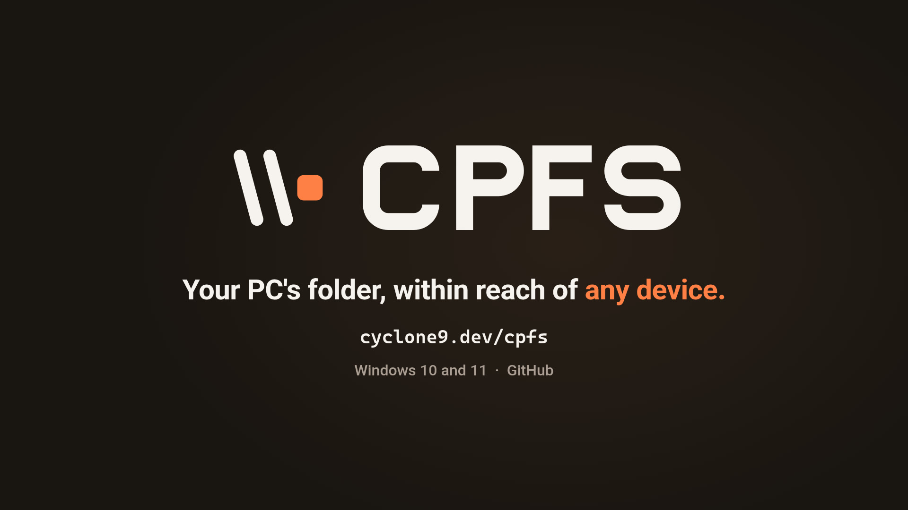

[English](README.md) · [فارسی](README.fa.md) · [العربية](README.ar.md) · [Türkçe](README.tr.md)

<div dir="rtl">

# CPFS - CyClone Power File Share

<p align="center"><picture><source media="(prefers-color-scheme: dark)" srcset="assets/cpfs-lockup-on-dark.svg"></picture></p>

<p align="center"><em>مجلد كمبيوترك في متناول كل جهاز.</em></p>

| الإصدار | 0.9.0 (قيد التطوير) |
|---|---|
| المنصة | ‏Windows 10 و 11 (الإصدار المنزلي أو الاحترافي) |
| المتطلبات | ‏.NET Framework 4.8 (مضمّن في Windows 10 الإصدار 1903 وما بعده وفي Windows 11)، صلاحيات المسؤول |
| الصفحة الرئيسية | https://cyclone9.dev/cpfs |
| الترخيص | ‏MIT (للشيفرة فقط؛ انظر [الترخيص](#الترخيص)) |

<p align="center"><a href="assets/cpfs-video-en.mp4"></a></p>

<p align="center" dir="rtl">نظرة سريعة مدتها 30 ثانية على CPFS. انقر على الصورة لفتح الفيديو.</p>

## ما الذي يفعله CPFS

يشارك CPFS مجلدًا واحدًا على كمبيوتر Windows 10 أو 11 مع أجهزة Windows وmacOS وLinux وAndroid وiOS. تتصل الأجهزة باسم الكمبيوتر (`ComputerName.local`)، أو بعنوانه على شبكة Wi-Fi أو الشبكة المحلية، أو بعنوان VPN، ويمكن للهاتف الاتصال برمز QR. تقتصر المشاركة على ذلك المجلد، بحساب منفصل وإعدادات Windows مُحصَّنة، ويعيد إلغاء التثبيت الإعدادات الأصلية.

## التنزيل والتشغيل الأول

‏CPFS ملف واحد هو `Cpfs-0.8.0.exe`، تجده في [صفحة الإصدارات](https://github.com/cyclone9/CPFS/releases) على GitHub. لا يوجد مثبّت: احفظ الملف في أي مكان وشغّله. لا يطلب CPFS صلاحيات المسؤول إلا حين يحتاجها الإعداد أو المراقبة أو إلغاء التثبيت. أما الاتصال واتصالات هذا الكمبيوتر والتفضيلات وحول فتعمل بدونها.

الملف غير موقَّع، ولذلك يعرض SmartScreen في Windows عند أول تشغيل الرسالة «قام Windows بحماية جهاز الكمبيوتر» (Windows protected your PC). اختر «مزيد من المعلومات» (More info) ثم «التشغيل على أي حال» (Run anyway).

للتحقق من أن الملف هو الملف المنشور، احسب قيمة SHA-256 له في PowerShell وقارنها بالقيمة المذكورة في صفحة الإصدار:

```powershell
Get-FileHash .\Cpfs-0.8.0.exe -Algorithm SHA256
```

يحتاج CPFS إلى Windows 10 أو 11 وإلى .NET Framework 4.8، وهو موجود في كليهما. جرى اختبار CPFS على Windows 11. أما Windows 10 فهو مدعوم لكنه لم يُختبر بعد.

بعد تشغيل CPFS يستطيع «حول» تثبيت الإصدارات اللاحقة؛ انظر [التحديث](#التحديث).

## المزايا

- صفحات للإعداد والمراقبة والاتصال واتصالات هذا الكمبيوتر وإلغاء التثبيت.
- مظهر Windows 11 مع سمة النظام والسمة الفاتحة والسمة الداكنة.
- الإنجليزية والفارسية والعربية والتركية. يستخدم CPFS لغة عرض Windows إذا كانت إحدى هذه اللغات، ويمكنك اختيار لغة أخرى من التفضيلات.
- يستطيع الإعداد أن يمنح المجلد المشترك حرف محرك أقراص واختصارًا على سطح المكتب وعنصرًا في جزء التنقل في مستكشف الملفات (File Explorer). تختار أنت الحرف والأسماء، وتحمل العناصر الثلاثة أيقونة CPFS. وعلى حرف المحرك قد يعرض المستكشف اسم القرص نفسه بدلًا من اسمك. أما عنصر جزء التنقل فهو الخيار «العرض في مستكشف الملفات»، وهو مفعّل افتراضيًا.
- قبل أن يغيّر الإعداد أو إلغاء التثبيت شيئًا في Windows، ينشئ CPFS نقطة استعادة ما لم تلغِ تحديدها. لا ينشئ Windows نقطة جديدة إذا مرّ أقل من 24 ساعة على السابقة، ويخبرك CPFS عندما يحدث ذلك.
- دليل اتصال لأنظمة Windows و macOS و Linux و Android و iOS، مع رموز QR للهواتف، عبر الاسم `.local` أو عنوان IP الخاص بشبكة Wi-Fi أو الشبكة المحلية، أو عنوان VPN. وتذكر خطوات Windows الخطأ 1219 وتشير إلى «اتصالات هذا الكمبيوتر».
- تسرد «اتصالات هذا الكمبيوتر» مشاركات SMB المتصل بها هذا الكمبيوتر وتقطع اتصالها. وهي للكمبيوتر الذي يتصل، لا للذي يشارك.
- تعرض المراقبة الأجهزة المتصلة وحركة البيانات، وعمليات النقل الكبيرة الجارية الآن («قيد النسخ الآن»)، والنشاط الأخير، ومحاولات تسجيل الدخول الفاشلة. يسرد النشاط الأخير كل ملف أُضيف أو تغيّر أو أُعيدت تسميته أو حُذف في المجلد المشترك، سواء من أي جهاز أو من هذا الكمبيوتر. ولا يستطيع CPFS معرفة أي جهاز أجرى التغيير.
- خيار اختياري «الحفظ في ملف سجل» للنشاط الأخير، وهو متوقف افتراضيًا.
- مفتاح اختياري لـ«خاصة تلقائيًا» وإمكانية اختيارية لتغيير اسم الكمبيوتر، وكلاهما موصوف أدناه.
- أيقونة اختيارية في علبة النظام تعرض ما إذا كانت المشاركة مفعّلة، وبدء اختياري مع Windows.
- زر «التحقق من وجود تحديثات» في صفحة «حول»، وتحقق اختياري عند بدء CPFS، وهو متوقف افتراضيًا. يسأل التحقق GitHub وحده. ولا ينزّل CPFS إصدارًا جديدًا إلا عندما تضغط «التحديث الآن»؛ انظر «التحديث».
- إلغاء التثبيت، وهو يعيد إعدادات Windows الأصلية.
- لا حذف لملفاتك. لا يحذف CPFS ولا ينقل ولا يستبدل شيئًا في المجلد المشترك من تلقاء نفسه.
- التعرّف على التثبيتات القائمة التي أُجريت بنصوص CPFS السابقة.

## خاصة تلقائيًا (Auto-Private)

على الشبكة المحلية، لا تتصل أجهزتك إلا عبر الشبكات التي يسميها Windows «خاصة» (انظر «التحصين الأمني»). «خاصة تلقائيًا» مفتاح في «خيارات إضافية» ضمن الإعداد. يضع هذا المفتاح علامة «خاصة» على كل شبكة ينضم إليها هذا الكمبيوتر لأول مرة، فتتصل أجهزتك دون تشغيل الإعداد من جديد. وهو متوقف افتراضيًا، والإيقاف أكثر أمانًا.

ويشمل ذلك شبكات Wi-Fi في المقاهي والفنادق والمطارات. لا يستطيع CPFS التمييز بين شبكة آمنة وأخرى غير آمنة، وقد يحاول غرباء على شبكة وُسمت «خاصة» تخمين كلمة مرور SMB الخاصة بك.

- عند اتصال شبكة، تضع مهمة مجدولة اسمها `CPFS-AutoPrivate` علامة «خاصة» عليها إذا كانت عامة ولم يرها CPFS من قبل. تُغيَّر كل شبكة مرة واحدة فقط.
- الشبكة التي تركتها عامة في الإعداد، والشبكة التي على محوّل VPN، لا تُغيَّران أبدًا.
- تعمل المهمة بحساب SYSTEM من نسخة من CPFS في `C:\Program Files\CPFS\Cpfs.exe`، ولا يستطيع تعديلها إلا SYSTEM والمسؤولون. وترفض المهمة العمل إذا كان ذلك المجلد أو `C:\ProgramData\CPFS` مفتوحًا لمستخدمين آخرين.
- تُحفظ أسماء الشبكات التي غيّرتها في `C:\ProgramData\CPFS\auto-private.log` ليتمكن إلغاء التثبيت من إعادتها إلى «عامة».
- إيقاف المفتاح في الإعداد يزيل المهمة والنسخة.

## اسم الكمبيوتر

تجد الأجهزة هذا الكمبيوتر باسمه متبوعًا بـ`.local`. يعرض حقل «اسم الكمبيوتر» ضمن «خيارات إضافية» في الإعداد الاسم الحالي، ولا يُعاد تسمية شيء ما لم تغيّره. استخدم أحرفًا وأرقامًا وشرطات، بما لا يتجاوز 15 حرفًا، على ألا يتألف الاسم من أرقام فقط.

لا يأخذ Windows الاسم الجديد إلا بعد إعادة التشغيل. ولا يعيد CPFS تسمية كمبيوتر منضم إلى مجال. وعلى كمبيوتر منضم إلى Entra ID، وقد تديره مؤسسة، لا يعيد التسمية إلا إذا حدّدت العنصر الذي يسأل عن ذلك. يُحفظ الاسم الأصلي في النسخة الاحتياطية، ويعرض إلغاء التثبيت إعادته، وذلك أيضًا بعد إعادة التشغيل.

## أيقونة علبة النظام والبدء مع Windows

أيقونة علبة النظام متوقفة افتراضيًا، وتفعّلها من «التفضيلات». تعرض ما إذا كانت المشاركة مفعّلة، وما إذا كان هذا الكمبيوتر على شبكة خاصة أو عامة، والشبكة العامة هي السبب المعتاد لعجز الهاتف عن الاتصال. تفتح قائمتها CPFS أو المجلد المشترك أو تُنهي الأيقونة، ويفتح النقر على الأيقونة CPFS. لا تعرض أي إشعارات: فقراءة محاولات تسجيل الدخول الفاشلة تتطلب صلاحيات المسؤول، ولذلك تبقى في «المراقبة».

لا تعمل الأيقونة أبدًا بصلاحيات المسؤول. وتنتهي إذا بدأت بها، فلا تتوفر على كمبيوتر أُوقف فيه التحكم في حساب المستخدم (UAC) أو في حساب Administrator المضمّن. نافذة CPFS التي تعمل بصلاحيات المسؤول تستطيع إيقاف الأيقونة ولا تستطيع تفعيلها. ولتفعيلها افتح CPFS بدون صلاحيات المسؤول.

وما دامت الأيقونة تعمل، فإن تصغير نافذة CPFS التي لا تعمل بصلاحيات المسؤول يرسلها إلى علبة النظام، وتعيدها الأيقونة. أما النافذة التي تعمل بصلاحيات المسؤول فتُصغَّر كالمعتاد. ويُنهي إغلاق النافذة CPFS وتبقى الأيقونة.

«البدء مع Windows» مفتاح في «التفضيلات» لا يتوفر إلا والأيقونة مفعّلة. يضيف قيمة اسمها `CPFS` تحت `HKCU\Software\Microsoft\Windows\CurrentVersion\Run` تشغّل الأيقونة، لا النافذة، من ملف exe الذي فعّلته منه. وهي مدرجة أيضًا في «الإعدادات > التطبيقات > بدء التشغيل» (Settings > Apps > Startup)، حيث يمكنك إدارتها كذلك. ويؤدي إيقاف الأيقونة إلى إيقاف «البدء مع Windows» أيضًا. وإذا نُقل ذلك الملف أو حُذف لاحقًا، تعرض «التفضيلات» المكان الذي كان Windows سيشغّله منه وتقترح «استخدام هذه النسخة» (Use this copy).

تُبقي الأيقونة العاملة ملف exe قيد الاستخدام. أنهِ الأيقونة، من قائمتها أو بالمفتاح في «التفضيلات»، قبل أن تحذف ملف exe أو تنقله.

يزيل إلغاء التثبيت قيمة البدء ويُغلق الأيقونة.

## اتصالات هذا الكمبيوتر

هذه الصفحة لكمبيوتر يتصل بخوادم أخرى. تعرض «الاتصال» كيف تصل الأجهزة الأخرى إلى هذا الكمبيوتر، وتعرض «اتصالات هذا الكمبيوتر» مشاركات SMB التي يتصل بها هذا الكمبيوتر، فهي الاتجاه المعاكس.

تسرد كل اتصال مع الخادم كما يحتفظ به Windows، والمشاركة، وحرف محرك الأقراص إن وُجد، والحساب، والحالة. وتُعلّم المحركات التي يُعاد اتصالها عند تسجيل الدخول، وتسرد كذلك المحركات المحفوظة غير المتصلة الآن. أما المحركات التي لا تستخدم SMB، مثل محرك من SSHFS-Win، فلا تُسرد. وحرف محرك CPFS نفسه ليس اتصالًا، فلا يُسرد أيضًا. ولا تطلب الصفحة أبدًا اسم مستخدم أو كلمة مرور.

يسأل «قطع الاتصال» أولًا، ولا ينهي إلا ذلك الاتصال. وإذا كان الاتصال محرك شبكة معيّنًا يُعاد اتصاله عند تسجيل الدخول، فإن «قطع الاتصال» ينساه أيضًا، كما يفعل مستكشف الملفات و`net use /delete`، وتذكر النافذة ذلك. ولاستعادته تعيّنه من جديد. وإذا كانت ملفات على الاتصال مفتوحة رفض Windows القطع. عندئذ تحذّر نافذة ثانية من أن التغييرات غير المحفوظة في تلك الملفات قد تضيع، ولا يفرض القطع إلا زر «قطع الاتصال على أي حال» (Disconnect anyway). أما «قطع كل الاتصالات بهذا الخادم» فيسأل مرة واحدة ولا يفرض القطع أبدًا. يسجّل CPFS ما قطعه دون أي كلمة مرور. وهذا «قطع الاتصال» ليس الموجود في «المراقبة»، فذاك ينهي جلسة جهاز على مشاركة هذا الكمبيوتر.

تعمل الصفحة فقط في نافذة لا تعمل بصلاحيات المسؤول. يحتفظ Windows بالاتصالات وربط المحركات لكل جلسة تسجيل دخول على حدة، والنافذة التي تعمل بصلاحيات المسؤول تتبع جلسة أخرى للمستخدم نفسه. وكانت ستسرد اتصالات خاطئة وتزيلها، ولذلك تعرض الصفحة هناك ملاحظة فقط دون قائمة.

### اسم مستخدم واحد لكل خادم

لا يسمح Windows إلا باسم مستخدم واحد لكل خادم في الوقت نفسه. فإذا اتصلت بخادم بحساب ثم اتصلت بالخادم نفسه بحساب آخر، رفض Windows بالخطأ 1219. يعتمد Windows على الاسم الذي كتبته، والاتصال بعنوان IP بدلًا من الاسم يُعدّ خادمًا آخر. وهذا هو الحل الذي تقترحه Microsoft نفسها لهذا الخطأ (مقال الدعم KB 938120).

وإذا ظهر الخطأ 1219 عند اتصالك بمشاركة CPFS من كمبيوتر Windows آخر، فافتح CPFS على ذلك الكمبيوتر وانتقل إلى «اتصالات هذا الكمبيوتر». اقطع الاتصال القائم بذلك الخادم، ثم اتصل من جديد بالحساب الذي تريده.

## التحديث

عندما يتوفر إصدار أحدث، يعرض «حول» الزر «التحديث الآن» (Update now). لا يحدّث CPFS نفسه بنفسه أبدًا، ولا يُنزَّل شيء حتى تضغط الزر الخاص بذلك الإصدار. ويعمل الزر فقط في نافذة لا تعمل بصلاحيات المسؤول؛ أما في النافذة التي تعمل بها فيبقى معطّلًا ويبقى رابط صفحة الإصدار. ولا تنزّل أيقونة علبة النظام ولا المهمة الخلفية أي شيء.

يعرض CPFS ما الجديد في الإصدار ويطلب تأكيدك. ثم ينزّل `Cpfs-<version>.exe` والملف `.sha256` الخاص به من ذلك الإصدار على GitHub عبر HTTPS ودون إرسال أي بيانات اعتماد. ولا يستبدل ملف exe إلا إذا تحققت كل هذه الشروط:

- الإصدار رقم إصدار عادي أعلى من الإصدار الجاري.
- قيمة SHA-256 للملف المنزَّل تطابق `.sha256` المنشور.
- الإصدار الموجود داخل الملف هو إصدار النسخة المنشورة.
- يبدأ ملف exe الجديد عندما يشغّله CPFS مرة واحدة قبل الاستبدال.

إذا فشل أحد الفحوص فلا يُستبدل شيء. يبقى ملف exe القديم بجانب الجديد إلى أن يفتح الجديد نافذته، ويعيده CPFS إلى مكانه إذا لم يبدأ الجديد.

تحمي قيمة SHA-256 من التنزيل التالف. ولا تحمي من حساب GitHub مُخترَق، لأن قيمة التحقق تأتي من الإصدار نفسه، ولا يوجد توقيع حتى الآن. ويظل التحديث اليدوي، كما في «التنزيل والتشغيل الأول»، ممكنًا.

لا يحصل الملف الذي يثبّته CPFS على علامة «تنزيل من الإنترنت»، فلا يسأل SmartScreen مرة أخرى. وهذا ليس توقيعًا: تنزيلك الأول يمرّ بـSmartScreen كالمعتاد، وتعتمد الإصدارات التي يثبّتها CPFS على HTTPS وGitHub وقيمة التحقق. ويظل Windows يعرض «ناشر غير معروف» (Unknown publisher) عندما يطلب CPFS صلاحيات المسؤول.

يحتفظ الملف باسمه ومجلده. فقد يحمل `Cpfs-0.9.0.exe` إصدارًا أحدث بعد التحديث، ويعرض «حول» وعنوان النافذة الإصدار الحقيقي. وتبقى الاختصارات والتثبيتات وعنصر البدء صالحة.

لا يستطيع CPFS استبدال ملف exe في مكانه على محرك شبكة أو في مجلد لا يستطيع الكتابة فيه، مثل مجلد تحت `C:\Program Files`. يقترح بدلًا من ذلك «حفظ باسم» (Save as) ويكتب الملف الذي جرى فحصه حيث تختار، ولا يطلب أبدًا صلاحيات المسؤول لكتابة ملف exe. وبعد ذلك يبقى عنصر البدء يشير إلى الملف القديم، وتقترح «التفضيلات» «استخدام هذه النسخة».

لا يغيّر التحديث النسخة الموجودة في `C:\Program Files\CPFS`. لا تتغير تلك النسخة إلا عندما تضغط «تطبيق» (Apply) في الإعداد، وإلى ذلك الحين تستمر «خاصة تلقائيًا» في استخدام النسخة الأقدم. ويخبرك CPFS بذلك بعد التحديث.

يضع CPFS أثناء عمله ملفات مؤقتة بجانب ملف exe، باسمه وبالامتدادات `.cpfs-old` و`.cpfs-failed` و`.cpfs-update.exe`. ويحذفها عند البدء التالي. وإذا انقطع تحديث في لحظة غير مناسبة وغاب ملف exe، فأعد تسمية الملف `.cpfs-old` باسم ملف exe.

## التحصين الأمني

يغيّر الإعداد إعدادات Windows المذكورة في هذا القسم ولا يغيّر غيرها. ولا يجعل أي إعداد أضعف من الافتراضي في Windows، ويُترك كما هو أي إعداد أشد صرامة أصلًا من قيمة CPFS. قبل أول تغيير، يحفظ الإعداد القيمة الأصلية لكل إعداد في `config.json` تحت `Backup`. ولا يأخذ النسخة الاحتياطية مرة أخرى، ولذلك يعيد إلغاء التثبيت القيم التي كانت قبل CPFS.

يعرض الإعداد خطة قبل أن يغيّر أي شيء. لا يُستخدم حساب موجود، ولا يُستبدل مشاركة، ولا تتحول شبكة عامة إلى خاصة، إلا إذا حدّدت ذلك.

### حساب SMB

| الإعداد | ما يضبطه CPFS | السبب |
|---|---|---|
| الحساب | حساب محلي منفصل تسمّيه في الإعداد اسم مستخدم SMB | تسجّل الأجهزة الدخول به، لا بحساب Windows الخاص بك |
| المجموعات | عضو في مجموعة المستخدمين (Users)، وليس في مجموعة المسؤولين (Administrators) | تسرّب كلمة مرور مشاركة الملفات لا يمكّن أحدًا من تغيير Windows |
| كلمة المرور | التي تكتبها؛ تُضبط عبر Windows ولا يحفظها CPFS | اترك الحقل فارغًا في تشغيل لاحق لتبقى الحالية |
| انتهاء كلمة المرور | لا تنتهي أبدًا | كلمة مرور منتهية الصلاحية تمنع كل الأجهزة من الدخول |
| شاشة تسجيل الدخول | مخفي، بالقيمة `0` تحت `HKLM\SOFTWARE\Microsoft\Windows NT\CurrentVersion\Winlogon\SpecialAccounts\UserList` | الحساب للأجهزة، لا لمن يجلس أمام هذا الكمبيوتر |
| يوجد حساب بالاسم نفسه | لا يُستخدم إلا إذا حدّدته؛ تُحفظ إعداداته أولًا، ويُعرض إخراجه من المسؤولين | لا يستولي CPFS على حساب بصمت |

### المجلد المشترك والمشاركة

| الإعداد | ما يضبطه CPFS | السبب |
|---|---|---|
| إذن المجلد | يحصل حساب SMB على «تعديل» (Modify) في المجلد المشترك وكل ما فيه | تستطيع الأجهزة إضافة الملفات وتعديلها |
| إذن المشاركة | لحساب SMB تحكم كامل في المشاركة، وهو الإدخال الوحيد الذي يضبطه CPFS؛ وتُحذف الإدخالات الأخرى فقط إذا حدّدتها | لا يصل إلى المشاركة غير ذلك الحساب |
| عرض المجلدات | تبقى المجلدات التي لا يستطيع الحساب فتحها مخفية | لا يظهر شيء خارج ما يملكه الحساب |
| الملفات دون اتصال | متوقفة للمشاركة | لا تُصنع نسخ دون اتصال من ملفاتك |
| الوضع الصارم (اختياري) | تشترط المشاركة تشفير SMB 3 | تُرفض الأجهزة التي لا تستطيع التشفير |
| المشاركات الإدارية (`ADMIN$` و`C$` وما شابهها) | القيمة `AutoShareWks` تساوي `0` تحت `HKLM\SYSTEM\CurrentControlSet\Services\LanmanServer\Parameters`؛ وتبقى الموجودة حتى إعادة التشغيل ما لم تحدّد حذفها | لا يشارك Windows الأقراص كاملة على الشبكة |
| مشاركة لم ينشئها CPFS | لا تُستبدل إلا إذا حدّدتها، ويُسجَّل ما كانت عليه | لا يحذف CPFS مشاركة دون أن يسألك |

### خادم SMB

| الإعداد | ما يضبطه CPFS | السبب |
|---|---|---|
| خدمة Server | تبدأ تلقائيًا | لا تعمل المشاركة بدونها |
| ‏SMB 2 وSMB 3 | مفعّلان | كل جهاز حديث يستخدم أحدهما |
| رفض الوصول غير المشفّر | مفعّل | الجهاز الذي طلب التشفير لا يستطيع بعد ذلك إعادة المحاولة بدونه |
| بروتوكول SMB 1 | متوقف | قديم وغير آمن، ويبقى متوقفًا |
| ميزة SMB 1 في Windows | تُزال إذا كانت مثبّتة؛ يتطلب ذلك إعادة التشغيل، ويُزال معها عميل SMB 1 الخاص بمحركات الشبكة القديمة جدًا | لا يعود SMB 1 عن طريق الخطأ |

### أمان تسجيل الدخول

السبعة الأولى قيم في السجل تحت `HKLM\SYSTEM\CurrentControlSet\Control\Lsa`، عدا `RestrictNullSessAccess` فهي تحت `HKLM\SYSTEM\CurrentControlSet\Services\LanmanServer\Parameters`.

| الإعداد | ما يضبطه CPFS | السبب |
|---|---|---|
| `forceguest` | `0` | يتم الدخول عبر الشبكة بالحساب المذكور، لا بحساب Guest |
| `LmCompatibilityLevel` | `5` | يُقبل NTLMv2 فقط |
| `NoLMHash` | `1` | لا يخزّن Windows تجزئة LM الضعيفة لكلمة المرور |
| `RestrictAnonymous` | `1` | لا يستطيع المستخدمون المجهولون سرد المشاركات وأسماء الحسابات |
| `RestrictAnonymousSAM` | `1` | لا يستطيع المستخدمون المجهولون سرد حسابات هذا الكمبيوتر |
| `EveryoneIncludesAnonymous` | `0` | لا تضم مجموعة Everyone المستخدمين المجهولين |
| `RestrictNullSessAccess` | `1` | لا تصل الجلسات المجهولة إلى المشاركات |
| حساب الضيف | متوقف ويبقى متوقفًا | لا وصول دون كلمة مرور |
| قفل الحساب | يُقفل الحساب بعد 10 كلمات مرور خاطئة. لا يُضبط هذا إلا إذا كان القفل متوقفًا؛ وأي حد لديك مسبقًا يبقى | تُحجب محاولات تخمين كلمة المرور |
| تدقيق تسجيلات الدخول الفاشلة | تُسجَّل المحاولات الفاشلة في سجل الأمان؛ وتبقى الناجحة كما كانت | تعرضها المراقبة |

### جدار الحماية والشبكات

| الإعداد | ما يضبطه CPFS | السبب |
|---|---|---|
| `CPFS SMB (LAN)` | ‏TCP وارد 445، الشبكات الخاصة، الشبكة الفرعية المحلية فقط | تتصل أجهزتك الموجودة على شبكتك |
| `CPFS mDNS (LAN)` | ‏UDP وارد 5353، الشبكات الخاصة | يعمل الاسم `.local` |
| `CPFS SMB (VPN)` | ‏TCP وارد 445 من `100.64.0.0/10` و`fd7a:115c:a1e0::/48`، عبر محوّل Tailscale أو Headscale فقط، وفقط إذا وُجد محوّل كهذا | تتصل أجهزتك عبر VPN. ولا يُستخدم محوّل على شبكة عامة إلا إذا حدّدته، لأن بعض شبكات الفنادق والجوال توزع عناوين من هذا النطاق نفسه |
| القواعد الجديدة | تُنشأ معطّلة ثم تُقرأ وتُفعَّل فقط إذا طابقت المطلوب | لا تفتح قاعدة بنطاق خاطئ منفذًا أبدًا |
| قواعد «مشاركة الملفات والطابعات» المضمّنة التي تفتح المنفذ 445 على الشبكات العامة | تُعطَّل وتُسجَّل ليتمكن إلغاء التثبيت من تفعيلها من جديد | لا يُفتح المنفذ 445 على شبكة عامة أبدًا |
| نوع الشبكة | لا تصبح الشبكة العامة خاصة إلا إذا حدّدتها | تسري قواعد CPFS على الشبكات التي تثق بها فقط |

### مجلد البيانات والوصول السريع

| الإعداد | ما يضبطه CPFS | السبب |
|---|---|---|
| `C:\ProgramData\CPFS` | مالكه مجموعة المسؤولين؛ ولا يكتب فيه إلا SYSTEM والمسؤولون | تقرأ مهمة تعمل بحساب SYSTEM من هذا المجلد، فلا يجوز لأي مستخدم آخر تعديله |
| خاصة تلقائيًا (اختياري) | المهمة `CPFS-AutoPrivate` والنسخة في `C:\Program Files\CPFS`؛ انظر «خاصة تلقائيًا» | توسم الشبكات الجديدة بأنها خاصة |
| اسم الكمبيوتر (اختياري) | اسم جديد بعد إعادة التشغيل؛ انظر «اسم الكمبيوتر» | تجد الأجهزة الكمبيوتر به |
| حرف محرك الأقراص (اختياري) | ربط دائم تحت `HKLM\SYSTEM\CurrentControlSet\Control\Session Manager\DOS Devices`، يظهر في جلستك فورًا أيضًا؛ حرف شاغر فقط | المجلد المشترك على هيئة محرك أقراص |
| اسم المحرك وأيقونته (اختياري) | قيم تحت `HKLM\SOFTWARE\Microsoft\Windows\CurrentVersion\Explorer\DriveIcons\<letter>`؛ وإذا كان للحرف اسم أو أيقونة من قبل فيُحفظان أولًا | يعرض مستكشف الملفات اسمك وأيقونة CPFS |
| اختصار سطح المكتب (اختياري) | ملف `.lnk` على سطح المكتب العام (Public Desktop)؛ ولا يُستبدل أبدًا ملف بالاسم نفسه لم ينشئه CPFS | اختصار إلى المجلد المشترك |
| عنصر مستكشف الملفات (اختياري) | المفاتيح المذكورة في قسم إلغاء التثبيت، في خلية المستخدم الذي شغّل الإعداد | المجلد المشترك في جزء التنقل |

يرفض CPFS مجلد بيانات هو رابط إلى مكان آخر، ولا يثق بملف إعدادات لم يكتبه مسؤول أو SYSTEM.

## إلغاء التثبيت

يعيد إلغاء التثبيت إعدادات Windows التي غيّرها الإعداد، ويزيل ما أنشأه CPFS. يبقى المجلد المشترك وما فيه من ملفات: لا يحذف CPFS ملفاتك أبدًا. وقبل أي تغيير ينشئ إلغاء التثبيت نقطة استعادة ما لم تلغِ تحديدها، ويحفظ نسخة من `config.json`، مع النسخة الاحتياطية من إعداداتك الأصلية ودون أي كلمة مرور، في مجلد Documents الخاص بك باسم `CPFS-config-backup-<date>-<time>.json`.

| العنصر | ما يفعله إلغاء التثبيت |
|---|---|
| المشاركة | يقطع اتصال الأجهزة ويحذف المشاركة. المشاركة التي تحمل الاسم نفسه وتشير إلى مجلد آخر تبقى ما لم تحدّدها. |
| إذن المجلد والملكية | يزيل الإذن الذي منحه الإعداد لحساب SMB. الملفات والمجلدات التي يملكها الحساب، مثل المرفوعات، تصبح مملوكة لمستخدم Windows الخاص بك. يمكنك إلغاء تحديد ذلك. |
| حساب SMB | يُحذف فقط إذا أنشأه CPFS. الحساب الذي كان موجودًا قبل ذلك يبقى ما لم تحدّد حذفه، وتعود إليه إعداداته السابقة للإعداد. ولا يُحذف مجلد ملف تعريف الحساب إلا إذا حدّدته. |
| جدار الحماية | يزيل قواعد CPFS ويعيد تفعيل القواعد المضمّنة التي عطّلها الإعداد. |
| إعدادات الأمان | يعيد القيم المحفوظة في النسخة الاحتياطية: بدء خدمة Server وSMB 2 وSMB 3 ورفض الوصول غير المشفّر وقفل الحساب وقيم السجل المذكورة في «التحصين الأمني». يبقى SMB 1 متوقفًا، ويبقى حساب الضيف متوقفًا، وتستمر محاولات تسجيل الدخول الفاشلة في التسجيل. ولا يجعل إلغاء التثبيت أبدًا أيًّا من `RestrictAnonymousSAM` و`RestrictNullSessAccess` و`NoLMHash` و`EveryoneIncludesAnonymous` أضعف مما يكون عليه في تثبيت Windows جديد. وأي قيمة لا أصل لها في النسخة الاحتياطية تُترك كما هي. |
| تثبيت بلا نسخة احتياطية | أنشأه إصدار مبكر من CPFS، فلا يُستعاد شيء. يمكنك تحديد عنصر يعيد المشاركات الإدارية ومستوى NTLM والوصول المجهول إلى افتراضيات Windows. |
| الشبكات | الشبكات التي حوّلها الإعداد إلى خاصة، وتلك التي حوّلتها «خاصة تلقائيًا»، تعود عامة. والشبكة غير المتصلة الآن تُغيَّر في قائمة الشبكات المحفوظة. |
| خاصة تلقائيًا | يزيل أولًا المهمة `CPFS-AutoPrivate`، ثم النسخة `C:\Program Files\CPFS\Cpfs.exe`، ثم المجلد `C:\Program Files\CPFS` إذا أنشأه CPFS وكان فارغًا. والمجلد الذي لم ينشئه CPFS يبقى. |
| اسم الكمبيوتر | يعرض إعادة الاسم الأصلي. يكون محدّدًا إذا كان الكمبيوتر ما زال يحمل الاسم الذي وضعه CPFS، وغير محدّد إذا غيّره أحد بعد ذلك. يأخذ Windows الاسم بعد إعادة التشغيل. |
| محرك الأقراص واسمه وأيقونته | يزيل ربط المحرك والاسم والأيقونة اللذين وضعهما CPFS، أو يعيد الاسم والأيقونة اللذين كانا للحرف من قبل. قد يعرض مستكشف الملفات المحرك حتى إعادة التشغيل التالية. وكل ما لم يضعه CPFS يبقى. |
| اختصار سطح المكتب | يُزال ما دام يشير إلى المجلد المشترك. |
| عنصر مستكشف الملفات | يُزال ما دام يفتح المجلد المشترك، كما هو موضح أدناه. |
| البدء مع Windows | يزيل القيمة `CPFS` تحت `HKCU\Software\Microsoft\Windows\CurrentVersion\Run` في خلية المستخدم الذي شغّل الإعداد، ويُغلق الأيقونة. والقيمة التي تحمل هذا الاسم ولم يكتبها CPFS تبقى. وتحتفظ حسابات Windows الأخرى بقيمها. |
| `C:\ProgramData\CPFS` | يُزال أخيرًا، مع `config.json` و`cpfs.ico`. أما ملفات الإعدادات التي استبعدها الإعداد (`config-ignored-<date>.json`) فتُنسخ قبل ذلك إلى مجلد Documents باسم `CPFS-config-ignored-<date>.json`؛ وإذا تعذّر النسخ يبقى المجلد. |

يتكوّن عنصر مستكشف الملفات من المفتاحين `HKCU\Software\Classes\CLSID\{07C33AB4-B371-467B-9DC1-1AA530E251C6}` و`HKCU\Software\Microsoft\Windows\CurrentVersion\Explorer\Desktop\NameSpace\{07C33AB4-B371-467B-9DC1-1AA530E251C6}`، ومن قيمة `{07C33AB4-B371-467B-9DC1-1AA530E251C6}` تحت `HKCU\Software\Microsoft\Windows\CurrentVersion\Explorer\HideDesktopIcons\NewStartPanel`، وكلها في خلية المستخدم الذي شغّل الإعداد. تُزال أيقونة محرك الأقراص `HKLM\SOFTWARE\Microsoft\Windows\CurrentVersion\Explorer\DriveIcons\<letter>\DefaultIcon`، أو تعود الأيقونة التي كانت للحرف من قبل. أما أيقونة لم يضعها CPFS فتبقى.

## أين يحفظ CPFS ملفاته

- المجلد `C:\ProgramData\CPFS`: الملف `config.json` وفيه إجاباتك ونسخة احتياطية من الإعدادات الأصلية، والملف `config-ignored-<date>.json` (ملف إعدادات لم يستطع CPFS الوثوق به، فيعيد الإعداد تسميته ولا يقرؤه بعد ذلك)، والملف `cpfs.ico` وهو أيقونة CPFS التي يستخدمها المحرك والاختصار وعنصر مستكشف الملفات، وحين تكون «خاصة تلقائيًا» مفعّلة الملفان `auto-private.log` (الشبكات التي غيّرتها) و`auto-private-run.log` (سطر واحد لكل تشغيل للمهمة). لا يكتب هنا إلا SYSTEM والمسؤولون.
- الملف `C:\Program Files\CPFS\Cpfs.exe`: النسخة التي تشغّلها مهمة «خاصة تلقائيًا»، ولا توجد إلا ما دام هذا المفتاح مفعّلًا. لا يستطيع تعديلها إلا SYSTEM والمسؤولون.
- المجلد `%LOCALAPPDATA%\CPFS` في ملف المستخدم الذي يشغّل CPFS:
  - الملف `preferences.json`: اختياراتك في التطبيق، مثل السمة واللغة والخط، وما إذا كانت أيقونة علبة النظام مفعّلة (`TrayIcon`)، وتبويب الجهاز الذي اخترته آخر مرة في «الاتصال» (`ConnectDevice`).
  - الملف `devices.json`: الأسماء التي أعطيتها للأجهزة المتصلة.
  - الملف `cpfs-log.txt`: سجل التطبيق نفسه.
  - الملفان `activity-log.txt` و`activity-log.old.txt`: النشاط الأخير، فقط ما دام «الحفظ في ملف سجل» مفعّلًا. عند بلوغ الملف 5 ميغابايت يصبح `activity-log.old.txt`. يحوي الملف أسماء ملفات، ولذلك لا يضمّه «نسخ التقرير» أبدًا. ولا يحذفه إلغاء التثبيت لأنه سجلّك أنت.
- القيمة `CPFS` تحت `HKCU\Software\Microsoft\Windows\CurrentVersion\Run`: عنصر البدء الخاص بـ«البدء مع Windows»، ولا توجد إلا ما دام هذا المفتاح مفعّلًا.
- بجانب ملف exe، أثناء التحديث فقط: ملفات تنتهي بـ`.cpfs-old` و`.cpfs-failed` و`.cpfs-update.exe`.
- الملف `Documents\CPFS-config-backup-<date>-<time>.json`: نسخة من `config.json` يحفظها إلغاء التثبيت قبل أي تغيير، ويتركها إلغاء التثبيت في مكانها.
- الملف `Documents\CPFS-config-ignored-<date>.json`: نسخة من ملف إعدادات مستبعد يحفظها إلغاء التثبيت قبل إزالة مجلد البيانات، ويتركها في مكانها.

لا يحذف إلغاء التثبيت شيئًا في `%LOCALAPPDATA%\CPFS`.

## الترخيص

يُنشر CPFS بموجب ترخيص MIT (انظر الملف `LICENSE`).

يشمل ترخيص MIT شيفرة CPFS ووثائقه. ولا يشمل اسم CPFS وشعاره، ولا أيقونة التطبيق (الملف `src/Cpfs/Assets/cpfs.ico` ورسمها في `src/Cpfs/Brand.xaml`)، ولا صور الأغلفة ومقاطع الفيديو في `assets/`. هذه الملفات مملوكة لـ CyClone وجميع حقوقها محفوظة. أما الموسيقى في مقاطع الفيديو فليست جزءًا من CPFS ولا يشملها ترخيص MIT.

خط Vazirmatn في `src/Cpfs/Assets/Fonts/` مرخّص بموجب SIL Open Font License 1.1 (الملف `OFL.txt` موجود هناك). أما المكتبات الخارجية فمذكورة في `THIRD-PARTY-NOTICES.md`.

‏© CyClone · https://cyclone9.dev/

</div>
