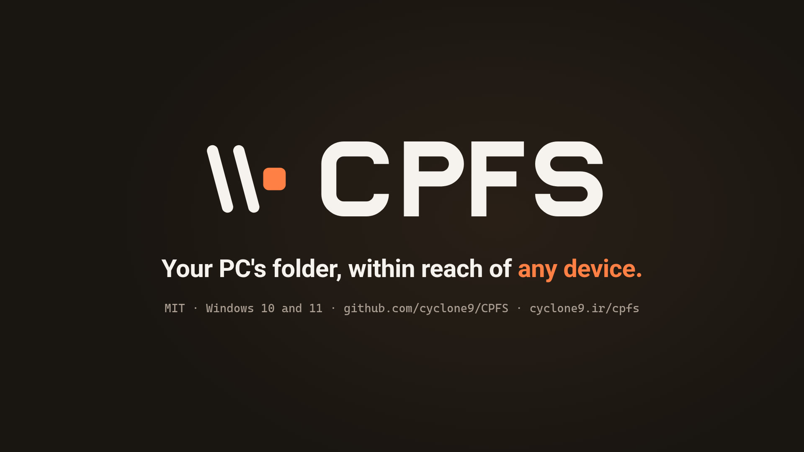

[English](README.md) · [فارسی](README.fa.md) · [العربية](README.ar.md) · [Türkçe](README.tr.md)

# CPFS - CyClone Power File Share

<picture><source media="(prefers-color-scheme: dark)" srcset="assets/brand/Logo/cpfs-lockup-on-dark.svg"></picture>

**العبارة التعريفية:** *مجلد كمبيوترك في متناول كل جهاز.*  
**الشعار:** *فقط المجلد الذي اخترته.*

| | |
|---|---|
| الإصدار | 0.7.0 (قيد التطوير) |
| المنصة | ‏Windows 10 و 11 (الإصدار المنزلي أو الاحترافي) |
| المتطلبات | ‏.NET Framework 4.8 (مضمّن في Windows 10 الإصدار 1903 وما بعده وفي Windows 11)، صلاحيات المسؤول |
| الصفحة الرئيسية | https://cyclone9.ir/cpfs |
| الترخيص | ‏MIT (للشيفرة فقط؛ انظر [الترخيص](#الترخيص)) |

يُعاد بناء CPFS الآن تطبيقًا لنظام Windows. لم يصدر منه إصدار بعد، فلا يوجد ما يمكن تنزيله، وكل ما يرد أدناه وصف لما يُراد للتطبيق أن يفعله.

## ما الذي يفعله CPFS

يشارك CPFS مجلدًا واحدًا على كمبيوتر Windows 10 أو 11 مع أجهزة Windows وmacOS وLinux وAndroid وiOS. تتصل الأجهزة باسم الكمبيوتر (`ComputerName.local`)، أو بعنوانه على شبكة Wi-Fi أو الشبكة المحلية، أو بعنوان VPN، ويمكن للهاتف الاتصال برمز QR. تقتصر المشاركة على ذلك المجلد، بحساب منفصل وإعدادات Windows مُحصَّنة، ويعيد إلغاء التثبيت الإعدادات الأصلية.

## ما الذي سيتوفر في التطبيق

- صفحات للإعداد والمراقبة والاتصال وإلغاء التثبيت.
- مظهر Windows 11 مع سمة النظام والسمة الفاتحة والسمة الداكنة.
- الإنجليزية أولًا، ثم الفارسية والعربية والتركية.
- يستطيع الإعداد أن يمنح المجلد المشترك حرف محرك أقراص واختصارًا على سطح المكتب وعنصرًا في جزء التنقل في مستكشف الملفات (File Explorer). تختار أنت الحرف والأسماء، وتحمل العناصر الثلاثة أيقونة CPFS. وعلى حرف المحرك قد يعرض المستكشف اسم القرص نفسه بدلًا من اسمك. أما عنصر جزء التنقل فهو الخيار «إظهار في مستكشف الملفات»، وهو مفعّل افتراضيًا.
- دليل اتصال برموز QR لأنظمة Windows و macOS و Linux و Android و iOS، عبر الاسم `.local` أو عنوان IP الخاص بشبكة Wi-Fi أو الشبكة المحلية، أو عنوان VPN.
- تعرض المراقبة الأجهزة المتصلة وحركة البيانات، وعمليات النقل الكبيرة الجارية الآن («قيد النسخ الآن»)، والنشاط الأخير، ومحاولات تسجيل الدخول الفاشلة. يسرد النشاط الأخير كل ملف أُضيف أو تغيّر أو أُعيدت تسميته أو حُذف في المجلد المشترك، سواء من أي جهاز أو من هذا الكمبيوتر. ولا يستطيع CPFS معرفة أي جهاز أجرى التغيير.
- خيار اختياري «الحفظ في ملف سجل» للنشاط الأخير، وهو متوقف افتراضيًا.
- زر «التحقق من وجود تحديثات» في صفحة «حول»، وتحقق اختياري عند بدء CPFS، وهو متوقف افتراضيًا. يسأل GitHub وحده ولا ينزّل شيئًا.
- إلغاء التثبيت، وهو يعيد إعدادات Windows الأصلية.
- لا حذف لملفاتك. لا يحذف CPFS ولا ينقل ولا يستبدل شيئًا في المجلد المشترك من تلقاء نفسه.
- التعرّف على التثبيتات القائمة التي أُجريت بنصوص CPFS السابقة.

## إلغاء التثبيت

يعيد إلغاء التثبيت إعدادات Windows التي غيّرها الإعداد، ويزيل ما أنشأه CPFS. يبقى المجلد المشترك وما فيه من ملفات. وهكذا تُعامَل عناصر الوصول السريع:

- يُزال عنصر File Explorer ما دام يفتح المجلد المشترك. يتكوّن العنصر من المفتاحين `HKCU\Software\Classes\CLSID\{07C33AB4-B371-467B-9DC1-1AA530E251C6}` و`HKCU\Software\Microsoft\Windows\CurrentVersion\Explorer\Desktop\NameSpace\{07C33AB4-B371-467B-9DC1-1AA530E251C6}`، ومن قيمة `{07C33AB4-B371-467B-9DC1-1AA530E251C6}` تحت `HKCU\Software\Microsoft\Windows\CurrentVersion\Explorer\HideDesktopIcons\NewStartPanel`، وكلها في خلية المستخدم الذي شغّل الإعداد.
- تُزال أيقونة محرك الأقراص `HKLM\SOFTWARE\Microsoft\Windows\CurrentVersion\Explorer\DriveIcons\<letter>\DefaultIcon`، أو تعود الأيقونة التي كانت للحرف من قبل. أما أيقونة لم يضعها CPFS فتبقى.
- يُحذف الملف `C:\ProgramData\CPFS\cpfs.ico` مع بقية `C:\ProgramData\CPFS`.

## أين يحفظ CPFS ملفاته

- المجلد `C:\ProgramData\CPFS`: الملف `config.json` وفيه إجاباتك ونسخة احتياطية من الإعدادات الأصلية، والملف `cpfs.ico` وهو أيقونة CPFS التي يستخدمها المحرك والاختصار وعنصر File Explorer.
- المجلد `%LOCALAPPDATA%\CPFS` في ملف المستخدم الذي يشغّل CPFS:
  - الملف `preferences.json`: اختياراتك في التطبيق، مثل السمة واللغة والخط.
  - الملف `devices.json`: الأسماء التي أعطيتها للأجهزة المتصلة.
  - الملف `cpfs-log.txt`: سجل التطبيق نفسه.
  - الملفان `activity-log.txt` و`activity-log.old.txt`: النشاط الأخير، فقط ما دام «الحفظ في ملف سجل» مفعّلًا. عند بلوغ الملف 5 ميغابايت يصبح `activity-log.old.txt`. يحوي الملف أسماء ملفات، ولذلك لا يضمّه «نسخ التقرير» أبدًا. ولا يحذفه إلغاء التثبيت لأنه سجلّك أنت.

لا يحذف إلغاء التثبيت شيئًا في `%LOCALAPPDATA%\CPFS`.

## الترخيص

الشيفرة مرخّصة بموجب MIT (انظر الملف `LICENSE`). اسم CPFS وشعاره ورموزه وعلامته الكتابية وأيقونة التطبيق غير مشمولة بهذا الترخيص، ولا يجوز استخدامها دون إذن. الملفات الموجودة في `assets/brand/` هي ملفات العلامة التجارية لـ CPFS وهي غير مشمولة بترخيص MIT. وخط Vazirmatn في `assets/fonts/` مرخّص بموجب SIL Open Font License 1.1 (الملف `OFL.txt` موجود هناك).

‏© CyClone · https://cyclone9.ir/

