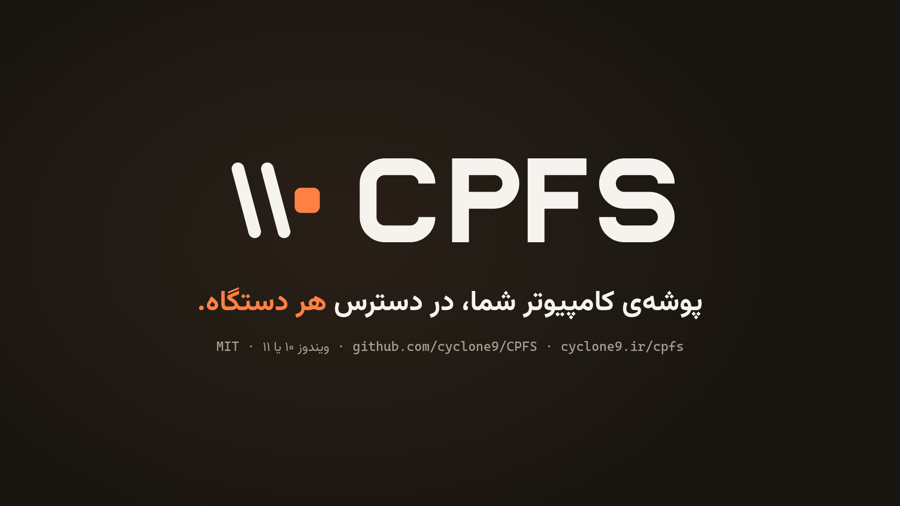

[English](README.md) · [فارسی](README.fa.md) · [العربية](README.ar.md) · [Türkçe](README.tr.md)

<div dir="rtl">

# CPFS - CyClone Power File Share

<p align="center"><picture><source media="(prefers-color-scheme: dark)" srcset="assets/cpfs-lockup-on-dark.svg"></picture></p>

<p align="center"><em>پوشه‌ی کامپیوتر شما، در دسترس هر دستگاه.</em></p>

| نسخه | 0.8.0 |
|---|---|
| پلتفرم | ‏Windows 10 و 11 (خانگی یا حرفه‌ای) |
| نیازها | ‏.NET Framework 4.8 (در Windows 10 نسخهٔ 1903 به بعد و در Windows 11 به‌صورت پیش‌فرض وجود دارد)، دسترسی مدیر |
| صفحهٔ اصلی | https://cyclone9.ir/cpfs |
| مجوز | ‏MIT (فقط کد؛ بخش [مجوز](#مجوز) را ببینید) |

<p align="center"><a href="assets/cpfs-video-fa.mp4"></a></p>

<p align="center" dir="rtl">نگاهی ۲۹ ثانیه‌ای به CPFS. برای باز کردن ویدیو روی تصویر کلیک کنید.</p>

## کاری که CPFS انجام می‌دهد

برنامه‌ی CPFS یک پوشه از کامپیوتر ویندوز ۱۰ یا ۱۱ را برای دستگاه‌های ویندوز، مک، لینوکس، اندروید و iOS باز می‌کند. دستگاه‌ها با نام کامپیوتر (`ComputerName.local`)، با نشانی وای‌فای یا شبکه‌ی محلی، یا با نشانی وی‌پی‌ان وصل می‌شوند و گوشی را می‌شود با کد QR وصل کرد. اشتراک فقط به همان پوشه محدود است، با حساب جدا و تنظیمات سخت‌گیرانه‌تر ویندوز، و حذف برنامه تنظیمات اولیه را برمی‌گرداند.

## دانلود و نخستین اجرا

‏CPFS یک فایل است: `Cpfs-0.8.0.exe` در [صفحه‌ی انتشارها](https://github.com/cyclone9/CPFS/releases) در GitHub. نصب‌کننده‌ای در کار نیست: فایل را هر جا خواستید ذخیره و اجرا کنید. CPFS فقط وقتی راه‌اندازی، پایش یا حذف نصب لازم داشته باشد دسترسی مدیر می‌خواهد. بخش‌های اتصال، ترجیحات و درباره بدون آن کار می‌کنند.

فایل امضا نشده است. برای همین بار اول که اجرایش کنید، SmartScreen در Windows پیام «Windows از رایانه‌ی شما محافظت کرد» (Windows protected your PC) را نشان می‌دهد. «اطلاعات بیشتر» (More info) و بعد «به هر حال اجرا شود» (Run anyway) را انتخاب کنید.

برای اطمینان از اینکه فایل همان فایل منتشرشده است، SHA-256 آن را در PowerShell حساب کنید و با مقدار صفحه‌ی انتشار مقایسه کنید:

```powershell
Get-FileHash .\Cpfs-0.8.0.exe -Algorithm SHA256
```

‏CPFS به Windows 10 یا 11 و .NET Framework 4.8 نیاز دارد، و این چارچوب در هر دو همراه سیستم است. CPFS روی Windows 11 آزمایش شده است. Windows 10 پشتیبانی می‌شود، اما هنوز آزمایش نشده است.

## امکانات

- صفحه‌هایی برای راه‌اندازی، پایش، اتصال و حذف نصب.
- ظاهری هم‌سبک Windows 11 با زمینه‌ی سیستم، روشن و تیره.
- انگلیسی، فارسی، عربی و ترکی. اگر زبان نمایش Windows یکی از این‌ها باشد CPFS از همان استفاده می‌کند و در ترجیحات می‌توانید زبان دیگری انتخاب کنید.
- راه‌اندازی می‌تواند به پوشه‌ی اشتراکی یک حرف درایو، یک میان‌بر روی دسکتاپ و یک ورودی در پنجره‌ی پیمایش کاوشگر فایل بدهد. حرف و نام‌ها را خودتان انتخاب می‌کنید و هر سه آیکن CPFS را دارند. روی حرف درایو ممکن است کاوشگر به‌جای نام شما نام خود دیسک را نشان دهد. ورودی پنجره‌ی پیمایش همان کلید «نمایش در کاوشگر فایل» است که به‌طور پیش‌فرض روشن است.
- پیش از آنکه راه‌اندازی یا حذف نصب چیزی را در Windows عوض کند، CPFS یک نقطه‌ی بازیابی می‌سازد، مگر اینکه علامتش را بردارید. Windows اگر کمتر از ۲۴ ساعت از نقطه‌ی قبلی گذشته باشد نقطه‌ی تازه نمی‌سازد و CPFS در این حالت به شما خبر می‌دهد.
- راهنمای اتصال برای Windows، macOS، Linux، Android و iOS، با کد QR برای گوشی‌ها، از راه نام `.local`، نشانی IP شبکه‌ی Wi-Fi یا LAN، یا نشانی VPN.
- پایش، دستگاه‌های وصل‌شده و ترافیک آن‌ها را نشان می‌دهد، همراه با انتقال‌های بزرگی که همین حالا در حال کپی‌شدن‌اند («در حال کپی‌شدن»)، فعالیت‌های اخیر و ورودهای ناموفق. فعالیت‌های اخیر هر فایلی را که در پوشه‌ی اشتراکی اضافه، تغییر، تغییر نام یا حذف شده فهرست می‌کند، چه از هر دستگاهی باشد چه از همین کامپیوتر. CPFS نمی‌تواند بگوید تغییر از کدام دستگاه آمده است.
- کلید اختیاری «ذخیره در فایل گزارش» برای فعالیت‌های اخیر، که به‌طور پیش‌فرض خاموش است.
- یک کلید اختیاری خصوصی خودکار و امکان اختیاری تغییر نام رایانه، که هر دو در ادامه توضیح داده شده‌اند.
- دکمه‌ی «بررسی به‌روزرسانی» در بخش درباره، و بررسی اختیاری هنگام شروع CPFS که به‌طور پیش‌فرض خاموش است. فقط از GitHub می‌پرسد و چیزی دانلود نمی‌کند.
- حذف نصب، که تنظیمات اصلی Windows را بازمی‌گرداند.
- حذف نشدن فایل‌هایتان. CPFS هرگز خودش چیزی را در پوشه‌ی اشتراکی حذف، جابه‌جا یا رونویسی نمی‌کند.
- شناسایی نصب‌های موجود که با اسکریپت‌های قدیمی‌تر CPFS انجام شده‌اند.

## خصوصی خودکار (Auto-Private)

در شبکه‌ی محلی، دستگاه‌های شما فقط از راه شبکه‌هایی وصل می‌شوند که Windows آن‌ها را «خصوصی» می‌نامد (بخش «سخت‌سازی امنیتی» را ببینید). «خصوصی خودکار» کلیدی در «گزینه‌های بیشتر» راه‌اندازی است. هر شبکه‌ای را که این کامپیوتر بار اول به آن وصل می‌شود خصوصی علامت می‌زند تا دستگاه‌هایتان بدون اجرای دوباره‌ی راه‌اندازی وصل شوند. این کلید به‌طور پیش‌فرض خاموش است و خاموش بودنش امن‌تر است.

وای‌فای کافه، هتل و فرودگاه هم شامل این کار می‌شود. CPFS نمی‌تواند شبکه‌ی امن را از ناامن تشخیص دهد و غریبه‌ها در شبکه‌ای که خصوصی علامت خورده می‌توانند گذرواژه‌ی SMB شما را حدس بزنند.

- هر بار که شبکه‌ای وصل می‌شود، وظیفه‌ی زمان‌بندی‌شده‌ای به نام `CPFS-AutoPrivate` آن را، اگر عمومی باشد و CPFS قبلاً ندیده باشدش، خصوصی علامت می‌زند. هر شبکه فقط یک بار تغییر می‌کند.
- شبکه‌ای که در راه‌اندازی عمومی گذاشته‌اید و شبکه‌ای که روی کارت شبکه‌ی VPN است هرگز تغییر نمی‌کنند.
- وظیفه با حساب SYSTEM و از یک رونوشت CPFS در `C:\Program Files\CPFS\Cpfs.exe` اجرا می‌شود که فقط SYSTEM و مدیران می‌توانند تغییرش دهند. اگر آن پوشه یا `C:\ProgramData\CPFS` برای کاربران دیگر باز باشد، وظیفه از اجرا خودداری می‌کند.
- نام شبکه‌هایی که تغییر داده در `C:\ProgramData\CPFS\auto-private.log` می‌ماند تا حذف نصب بتواند آن‌ها را دوباره عمومی کند.
- خاموش کردن کلید در راه‌اندازی، وظیفه و رونوشت را حذف می‌کند.

## نام رایانه

دستگاه‌ها این کامپیوتر را با نام رایانه و بعد `.local` پیدا می‌کنند. قسمت «نام رایانه» در «گزینه‌های بیشتر» راه‌اندازی نام فعلی را نشان می‌دهد و تا وقتی تغییرش ندهید چیزی تغییر نام نمی‌دهد. از حرف، رقم و خط تیره استفاده کنید، تا ۱۵ نویسه، و نه فقط رقم.

‏Windows نام تازه را فقط پس از راه‌اندازی مجدد می‌پذیرد. CPFS رایانه‌ای را که عضو دامنه است تغییر نام نمی‌دهد. روی رایانه‌ای که به Entra ID پیوسته است و ممکن است سازمانی آن را مدیریت کند، فقط وقتی تغییر نام می‌دهد که گزینه‌ی مربوطش را علامت بزنید. نام اصلی در پشتیبان نگه داشته می‌شود و حذف نصب آن را پیشنهاد می‌کند، آن هم پس از راه‌اندازی مجدد.

## سخت‌سازی امنیتی

راه‌اندازی فقط تنظیمات Windows را که در این بخش آمده تغییر می‌دهد، نه چیز دیگری. هیچ تنظیمی را ضعیف‌تر از پیش‌فرض Windows نمی‌کند و تنظیمی که از مقدار CPFS سخت‌گیرانه‌تر باشد همان‌طور که هست می‌ماند. پیش از نخستین تغییر، راه‌اندازی مقدار اصلی هر تنظیم را در `config.json` زیر `Backup` ذخیره می‌کند. پشتیبان را دیگر تکرار نمی‌کند، برای همین حذف نصب مقدارهای پیش از CPFS را برمی‌گرداند.

راه‌اندازی پیش از تغییر هر چیز، طرحی نشان می‌دهد. استفاده از حسابی که از قبل بوده، جایگزین کردن یک اشتراک و خصوصی کردن شبکه‌ی عمومی فقط وقتی انجام می‌شوند که علامتشان بزنید.

### حساب SMB

| تنظیم | آنچه CPFS می‌گذارد | دلیل |
|---|---|---|
| حساب | یک حساب محلی جدا که در راه‌اندازی به‌عنوان نام کاربری SMB می‌دهید | دستگاه‌ها با آن وارد می‌شوند، نه با حساب Windows شما |
| گروه‌ها | عضو گروه کاربران (Users)، نه گروه مدیران (Administrators) | اگر گذرواژه‌ی اشتراک فایل لو برود، نمی‌تواند Windows را تغییر دهد |
| گذرواژه | همان که تایپ می‌کنید؛ از راه Windows گذاشته می‌شود و CPFS ذخیره‌اش نمی‌کند | در اجرای بعدی کادر را خالی بگذارید تا گذرواژه‌ی فعلی بماند |
| انقضای گذرواژه | هرگز منقضی نمی‌شود | گذرواژه‌ی منقضی‌شده همه‌ی دستگاه‌ها را بیرون می‌کرد |
| صفحه‌ی ورود | پنهان، با مقدار `0` زیر `HKLM\SOFTWARE\Microsoft\Windows NT\CurrentVersion\Winlogon\SpecialAccounts\UserList` | حساب برای دستگاه‌هاست، نه برای کسی که پای این کامپیوتر نشسته |
| حسابی با همین نام از قبل هست | فقط اگر علامتش بزنید استفاده می‌شود؛ تنظیمات آن اول ذخیره می‌شود و بیرون آوردنش از گروه مدیران پیشنهاد می‌شود | ‏CPFS حسابی را بی‌صدا در اختیار نمی‌گیرد |

### پوشه‌ی اشتراکی و اشتراک

| تنظیم | آنچه CPFS می‌گذارد | دلیل |
|---|---|---|
| دسترسی به پوشه | حساب SMB روی پوشه‌ی اشتراکی و هر چه در آن است دسترسی «تغییر» (Modify) می‌گیرد | دستگاه‌ها می‌توانند فایل اضافه و ویرایش کنند |
| دسترسی به اشتراک | حساب SMB کنترل کامل اشتراک را دارد و این تنها موردی است که CPFS می‌گذارد؛ موردهای دیگر فقط اگر علامتشان بزنید حذف می‌شوند | فقط همان حساب به اشتراک می‌رسد |
| فهرست پوشه‌ها | پوشه‌هایی که حساب نمی‌تواند باز کند پنهان می‌مانند | چیزی خارج از دسترس حساب نشان داده نمی‌شود |
| فایل‌های آفلاین | برای اشتراک خاموش | نسخه‌ی آفلاینی از فایل‌هایتان ساخته نمی‌شود |
| حالت سخت‌گیرانه (اختیاری) | اشتراک رمزگذاری SMB 3 را الزامی می‌کند | دستگاه‌هایی که رمزگذاری ندارند رد می‌شوند |
| اشتراک‌های مدیریتی (`ADMIN$`، `C$` و مانند آن) | ‏`AutoShareWks` برابر `0` زیر `HKLM\SYSTEM\CurrentControlSet\Services\LanmanServer\Parameters`؛ موردهای موجود تا راه‌اندازی مجدد می‌مانند، مگر اینکه حذفشان را علامت بزنید | ‏Windows دیگر درایوهای کامل را در شبکه به اشتراک نمی‌گذارد |
| اشتراکی که CPFS نساخته | فقط اگر علامتش بزنید جایگزین می‌شود و آنچه بوده ثبت می‌شود | ‏CPFS بدون پرسیدن هیچ اشتراکی را حذف نمی‌کند |

### سرور SMB

| تنظیم | آنچه CPFS می‌گذارد | دلیل |
|---|---|---|
| سرویس Server | خودکار شروع می‌شود | اشتراک‌گذاری بدون آن کار نمی‌کند |
| ‏SMB 2 و SMB 3 | روشن | هر دستگاه امروزی یکی از آن‌ها را به کار می‌برد |
| رد دسترسی رمزگذاری‌نشده | روشن | دستگاهی که رمزگذاری خواسته نمی‌تواند بعد بدون آن دوباره تلاش کند |
| پروتکل SMB 1 | خاموش | قدیمی و ناامن است و خاموش می‌ماند |
| ویژگی SMB 1 در Windows | اگر نصب باشد برداشته می‌شود؛ این کار راه‌اندازی مجدد می‌خواهد و کلاینت SMB 1 برای درایوهای شبکه‌ی خیلی قدیمی را هم برمی‌دارد | ‏SMB 1 به‌اشتباه برنمی‌گردد |

### امنیت ورود

هفت مورد اول مقدارهای رجیستری زیر `HKLM\SYSTEM\CurrentControlSet\Control\Lsa` هستند، جز `RestrictNullSessAccess` که زیر `HKLM\SYSTEM\CurrentControlSet\Services\LanmanServer\Parameters` است.

| تنظیم | آنچه CPFS می‌گذارد | دلیل |
|---|---|---|
| `forceguest` | `0` | ورود از راه شبکه با همان حسابی انجام می‌شود که نامش آمده، نه با Guest |
| `LmCompatibilityLevel` | `5` | فقط NTLMv2 پذیرفته می‌شود |
| `NoLMHash` | `1` | ‏Windows هش ضعیف LM گذرواژه را نگه نمی‌دارد |
| `RestrictAnonymous` | `1` | کاربران ناشناس نمی‌توانند اشتراک‌ها و نام حساب‌ها را فهرست کنند |
| `RestrictAnonymousSAM` | `1` | کاربران ناشناس نمی‌توانند حساب‌های این کامپیوتر را فهرست کنند |
| `EveryoneIncludesAnonymous` | `0` | گروه Everyone کاربران ناشناس را شامل نمی‌شود |
| `RestrictNullSessAccess` | `1` | نشست‌های ناشناس به اشتراک‌ها نمی‌رسند |
| حساب مهمان | خاموش و خاموش‌مانده | دسترسی بدون گذرواژه وجود ندارد |
| قفل شدن حساب | حساب بعد از ۱۰ گذرواژه‌ی غلط قفل می‌شود. این فقط وقتی گذاشته می‌شود که قفل شدن خاموش باشد؛ آستانه‌ای که از قبل دارید می‌ماند | حدس زدن گذرواژه مسدود می‌شود |
| ثبت ورودهای ناموفق | شکست‌ها در گزارش امنیتی ثبت می‌شوند؛ ورودهای موفق همان‌طور که بودند می‌مانند | پایش آن‌ها را نشان می‌دهد |

### فایروال و شبکه‌ها

| تنظیم | آنچه CPFS می‌گذارد | دلیل |
|---|---|---|
| `CPFS SMB (LAN)` | ‏TCP ورودی 445، شبکه‌های خصوصی، فقط زیرشبکه‌ی محلی | دستگاه‌های شما در شبکه‌تان می‌توانند وصل شوند |
| `CPFS mDNS (LAN)` | ‏UDP ورودی 5353، شبکه‌های خصوصی | نام `.local` کار می‌کند |
| `CPFS SMB (VPN)` | ‏TCP ورودی 445 از `100.64.0.0/10` و `fd7a:115c:a1e0::/48`، فقط از راه کارت شبکه‌ی Tailscale یا Headscale و فقط وقتی چنین کارتی پیدا شود | دستگاه‌های شما از راه VPN وصل می‌شوند. کارتی که روی شبکه‌ی عمومی است فقط اگر علامتش بزنید به کار می‌رود، چون بعضی شبکه‌های هتل و موبایل از همین بازه نشانی می‌دهند |
| قانون‌های تازه | غیرفعال ساخته می‌شوند، دوباره خوانده می‌شوند و فقط در صورت تطابق فعال می‌شوند | قانونی با دامنه‌ی نادرست هرگز درگاهی را باز نمی‌کند |
| قانون‌های داخلی «اشتراک فایل و چاپگر» که درگاه 445 را در شبکه‌های عمومی باز می‌کنند | غیرفعال و ثبت می‌شوند تا حذف نصب بتواند دوباره فعالشان کند | درگاه 445 هرگز در شبکه‌ی عمومی باز نمی‌شود |
| نوع شبکه | شبکه‌ی عمومی فقط اگر علامتش بزنید خصوصی می‌شود | قانون‌های CPFS فقط در شبکه‌هایی که به آن‌ها اعتماد دارید اعمال می‌شوند |

### پوشه‌ی داده و دسترسی سریع

| تنظیم | آنچه CPFS می‌گذارد | دلیل |
|---|---|---|
| `C:\ProgramData\CPFS` | مالک آن گروه مدیران است؛ فقط SYSTEM و مدیران می‌توانند در آن بنویسند | وظیفه‌ای که با SYSTEM اجرا می‌شود از این پوشه می‌خواند، پس هیچ کاربر دیگری نباید بتواند آن را تغییر دهد |
| خصوصی خودکار (اختیاری) | وظیفه‌ی `CPFS-AutoPrivate` و رونوشت در `C:\Program Files\CPFS`؛ بخش «خصوصی خودکار» را ببینید | شبکه‌های تازه خصوصی علامت می‌خورند |
| نام رایانه (اختیاری) | نامی تازه پس از راه‌اندازی مجدد؛ بخش «نام رایانه» را ببینید | دستگاه‌ها کامپیوتر را با آن پیدا می‌کنند |
| حرف درایو (اختیاری) | نگاشتی دائمی زیر `HKLM\SYSTEM\CurrentControlSet\Control\Session Manager\DOS Devices` که در نشست شما هم بلافاصله دیده می‌شود؛ فقط حرفی که آزاد باشد | پوشه‌ی اشتراکی به‌شکل یک درایو |
| نام و آیکن درایو (اختیاری) | مقدارهایی زیر `HKLM\SOFTWARE\Microsoft\Windows\CurrentVersion\Explorer\DriveIcons\<letter>`؛ نام یا آیکنی که حرف از قبل دارد اول ذخیره می‌شود | کاوشگر فایل نام شما و آیکن CPFS را نشان می‌دهد |
| میان‌بر دسکتاپ (اختیاری) | فایلی با پسوند `.lnk` روی دسکتاپ عمومی (Public Desktop)؛ فایلی با همین نام که CPFS نساخته باشد هرگز رونویسی نمی‌شود | میان‌بری به پوشه‌ی اشتراکی |
| ورودی کاوشگر فایل (اختیاری) | کلیدهایی که در بخش حذف نصب فهرست شده‌اند، در شاخه‌ی کاربری که راه‌اندازی را اجرا کرده | پوشه‌ی اشتراکی در پنجره‌ی پیمایش |

پوشه‌ی داده‌ای که پیوندی به مکانی دیگر باشد را CPFS نمی‌پذیرد، و به فایل تنظیماتی که مدیر یا SYSTEM ننوشته باشد اعتماد نمی‌کند.

## حذف نصب

حذف نصب تنظیمات Windows را که راه‌اندازی تغییر داده برمی‌گرداند و هر چه CPFS ساخته حذف می‌کند. پوشه‌ی اشتراکی و فایل‌های داخل آن می‌مانند: CPFS هرگز فایل‌هایتان را حذف نمی‌کند. پیش از هر تغییر، حذف نصب یک نقطه‌ی بازیابی می‌سازد، مگر اینکه علامتش را بردارید، و رونوشتی از `config.json` را، همراه با پشتیبان تنظیمات اصلی و بدون هیچ گذرواژه‌ای، با نام `CPFS-config-backup-<date>-<time>.json` در پوشه‌ی Documents شما ذخیره می‌کند.

| چه چیزی | حذف نصب چه می‌کند |
|---|---|
| اشتراک | دستگاه‌ها را قطع و اشتراک را حذف می‌کند. اشتراکی با همین نام که به پوشه‌ی دیگری اشاره کند می‌ماند، مگر اینکه علامتش بزنید. |
| دسترسی پوشه و مالکیت | دسترسی‌ای را که راه‌اندازی به حساب SMB داده برمی‌دارد. فایل‌ها و پوشه‌هایی که مالک آن‌ها حساب است، مثل فایل‌های بارگذاری‌شده، به کاربر Windows شما می‌رسند. می‌توانید علامتش را بردارید. |
| حساب SMB | فقط اگر CPFS ساخته باشد حذف می‌شود. حسابی که از قبل بوده می‌ماند، مگر اینکه حذفش را علامت بزنید، و تنظیمات پیش از راه‌اندازی‌اش را پس می‌گیرد. پوشه‌ی نمایه‌ی حساب فقط اگر علامتش بزنید حذف می‌شود. |
| فایروال | قانون‌های CPFS را حذف می‌کند و قانون‌های داخلی را که راه‌اندازی غیرفعال کرده دوباره فعال می‌کند. |
| تنظیمات امنیتی | مقدارهای ذخیره‌شده در پشتیبان را برمی‌گرداند: شروع سرویس Server، SMB 2 و SMB 3، رد دسترسی رمزگذاری‌نشده، قفل شدن حساب و مقدارهای رجیستری بخش سخت‌سازی امنیتی. SMB 1 خاموش می‌ماند، حساب مهمان خاموش می‌ماند و ورودهای ناموفق همچنان ثبت می‌شوند. حذف نصب هرگز مقدارهای `RestrictAnonymousSAM`، `RestrictNullSessAccess`، `NoLMHash` و `EveryoneIncludesAnonymous` را ضعیف‌تر از یک نصب تازه‌ی Windows تنظیم نمی‌کند. مقداری که پشتیبان برایش مقدار اصلی ندارد همان‌طور که هست می‌ماند. |
| نصب بدون پشتیبان | نسخه‌ی قدیمی CPFS آن را ساخته است، پس چیزی بازیابی نمی‌شود. می‌توانید مورد را علامت بزنید تا اشتراک‌های مدیریتی، سطح NTLM و دسترسی ناشناس به پیش‌فرض Windows برگردند. |
| شبکه‌ها | شبکه‌هایی که راه‌اندازی خصوصی کرده و آن‌هایی که خصوصی خودکار خصوصی کرده دوباره عمومی می‌شوند. شبکه‌ای که الان وصل نیست در فهرست شبکه‌های ذخیره‌شده تغییر می‌کند. |
| خصوصی خودکار | اول وظیفه‌ی `CPFS-AutoPrivate`، بعد رونوشت `C:\Program Files\CPFS\Cpfs.exe` و بعد، اگر CPFS ساخته و خالی باشد، پوشه‌ی `C:\Program Files\CPFS` را حذف می‌کند. پوشه‌ای که CPFS نساخته باشد می‌ماند. |
| نام رایانه | نام اصلی را پیشنهاد می‌کند. اگر رایانه هنوز نامی دارد که CPFS گذاشته، علامت‌خورده است و اگر از آن موقع کس دیگری تغییرش داده، بدون علامت. Windows نام را پس از راه‌اندازی مجدد می‌پذیرد. |
| درایو، نام و آیکن درایو | نگاشت درایو و نام و آیکنی را که CPFS گذاشته برمی‌دارد، یا نام و آیکنی را که حرف از قبل داشت پس می‌گذارد. کاوشگر فایل ممکن است درایو را تا راه‌اندازی مجدد بعدی نشان دهد. هر چه CPFS نگذاشته باشد می‌ماند. |
| میان‌بر دسکتاپ | تا وقتی هنوز به پوشه‌ی اشتراکی اشاره می‌کند حذف می‌شود. |
| ورودی کاوشگر فایل | تا وقتی هنوز پوشه‌ی اشتراکی را باز می‌کند، همان‌طور که پایین‌تر آمده حذف می‌شود. |
| `C:\ProgramData\CPFS` | آخر از همه، همراه با `config.json` و `cpfs.ico`، حذف می‌شود. فایل‌های تنظیماتی که راه‌اندازی کنار گذاشته (`config-ignored-<date>.json`) پیش از آن در پوشه‌ی Documents شما با نام `CPFS-config-ignored-<date>.json` کپی می‌شوند؛ اگر کپی شکست بخورد، پوشه می‌ماند. |

ورودی کاوشگر فایل از کلیدهای `HKCU\Software\Classes\CLSID\{07C33AB4-B371-467B-9DC1-1AA530E251C6}` و `HKCU\Software\Microsoft\Windows\CurrentVersion\Explorer\Desktop\NameSpace\{07C33AB4-B371-467B-9DC1-1AA530E251C6}` و یک مقدار `{07C33AB4-B371-467B-9DC1-1AA530E251C6}` زیر `HKCU\Software\Microsoft\Windows\CurrentVersion\Explorer\HideDesktopIcons\NewStartPanel` ساخته شده، همه در شاخه‌ی کاربری که راه‌اندازی را اجرا کرده است. آیکن درایو، `HKLM\SOFTWARE\Microsoft\Windows\CurrentVersion\Explorer\DriveIcons\<letter>\DefaultIcon`، حذف می‌شود یا آیکنی که آن حرف پیش از این داشت برمی‌گردد. آیکنی که CPFS نگذاشته باشد می‌ماند.

## داده‌های CPFS کجا ذخیره می‌شوند

- پوشه‌ی `C:\ProgramData\CPFS`: فایل `config.json` با پاسخ‌های شما و نسخه‌ی پشتیبان تنظیمات اصلی، فایل `config-ignored-<date>.json` (فایل تنظیماتی که CPFS نمی‌توانست به آن اعتماد کند و راه‌اندازی نامش را عوض می‌کند و دیگر نمی‌خواندش)، فایل `cpfs.ico`، آیکن CPFS که درایو، میان‌بر و ورودی کاوشگر فایل از آن استفاده می‌کنند، و وقتی خصوصی خودکار روشن است `auto-private.log` (شبکه‌هایی که تغییر داده) و `auto-private-run.log` (برای هر اجرای وظیفه یک خط). فقط SYSTEM و مدیران می‌توانند اینجا بنویسند.
- فایل `C:\Program Files\CPFS\Cpfs.exe`: رونوشتی که وظیفه‌ی خصوصی خودکار اجرا می‌کند و فقط تا وقتی این کلید روشن است وجود دارد. فقط SYSTEM و مدیران می‌توانند تغییرش دهند.
- پوشه‌ی `%LOCALAPPDATA%\CPFS` در پروفایل کاربری که CPFS را اجرا می‌کند:
  - فایل `preferences.json`: انتخاب‌های شما در برنامه، مثل زمینه، زبان و قلم.
  - فایل `devices.json`: نام‌هایی که به دستگاه‌های وصل‌شده داده‌اید.
  - فایل `cpfs-log.txt`: گزارش کار خود برنامه.
  - فایل‌های `activity-log.txt` و `activity-log.old.txt`: فعالیت‌های اخیر، فقط تا وقتی «ذخیره در فایل گزارش» روشن است. وقتی فایل به ۵ مگابایت برسد، به `activity-log.old.txt` تبدیل می‌شود. نام فایل‌ها در آن هست، برای همین «رونوشت گزارش» هرگز آن را شامل نمی‌شود. حذف نصب آن را پاک نمی‌کند، چون گزارش خود شماست.
- فایل `Documents\CPFS-config-backup-<date>-<time>.json`: رونوشتی از `config.json` که حذف نصب پیش از هر تغییر ذخیره می‌کند. حذف نصب آن را سر جایش می‌گذارد.
- فایل `Documents\CPFS-config-ignored-<date>.json`: رونوشت فایل تنظیمات کنار گذاشته‌شده که حذف نصب پیش از حذف پوشه‌ی داده ذخیره می‌کند. حذف نصب آن را سر جایش می‌گذارد.

حذف نصب چیزی را در `%LOCALAPPDATA%\CPFS` پاک نمی‌کند.

## مجوز

نرم‌افزار CPFS تحت مجوز MIT منتشر شده است (فایل `LICENSE` را ببینید).

مجوز MIT کد و مستندات CPFS را در بر می‌گیرد. نام و لوگوی CPFS، آیکن برنامه (فایل `src/Cpfs/Assets/cpfs.ico` و طرح آن در `src/Cpfs/Brand.xaml`) و تصاویر روی جلد و ویدیوهای پوشهٔ `assets/` شامل این مجوز نمی‌شوند. این‌ها متعلق به CyClone است و همهٔ حقوق آن‌ها محفوظ است. موسیقی ویدیوها بخشی از CPFS نیست و مجوز MIT شامل آن نمی‌شود.

قلم Vazirmatn در پوشهٔ `src/Cpfs/Assets/Fonts/` تحت مجوز SIL Open Font License 1.1 است (فایل `OFL.txt` همان‌جاست). کتابخانه‌های شخص ثالث در `THIRD-PARTY-NOTICES.md` فهرست شده‌اند.

‏© CyClone · https://cyclone9.ir/

</div>
