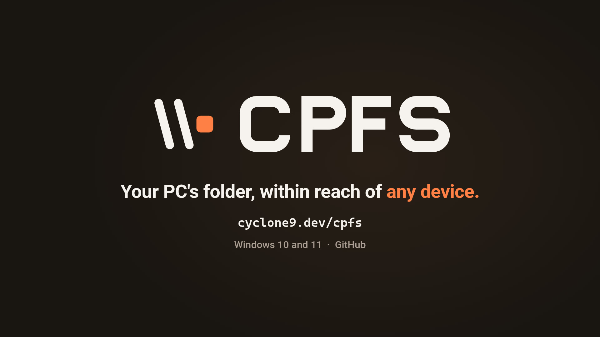

[English](README.md) · [فارسی](README.fa.md) · [العربية](README.ar.md) · [Türkçe](README.tr.md)

# CPFS - CyClone Power File Share

<p align="center"><picture><source media="(prefers-color-scheme: dark)" srcset="assets/cpfs-lockup-on-dark.svg"></picture></p>

<p align="center"><em>Your PC's folder, within reach of any device.</em></p>

| Version | 1.0.0 (in development) |
|---|---|
| Platform | Windows 10 and 11 (Home or Pro) |
| Requires | .NET Framework 4.8 (built into Windows 10 1903 and later and Windows 11), Administrator rights |
| Homepage | https://cyclone9.dev/cpfs |
| Licence | MIT (code only; see [Licence](#licence)) |

<p align="center"><a href="assets/cpfs-video-en.mp4"></a></p>

<p align="center">A 30-second look at CPFS. Click the image to open the video.</p>

## What CPFS does

CPFS shares one folder on a Windows 10 or 11 PC with Windows, macOS, Linux, Android and iOS devices. They connect by the PC's name (ComputerName.local), by its Wi-Fi or LAN address, or by a VPN address, and a phone can connect with a QR code. Sharing is limited to that folder, with a separate account and hardened Windows settings, and the uninstall puts the original settings back.

## Download and first run

CPFS is one file, `Cpfs-0.8.0.exe`, on the [releases page](https://github.com/cyclone9/CPFS/releases) on GitHub. There is no installer: save the file anywhere and run it. CPFS asks for administrator rights only when Setup, Monitor or Uninstall need them. Connect, Shared folders on other PCs, Preferences and About work without.

The file is not signed, so the first time you run it Windows SmartScreen shows "Windows protected your PC". Select More info, then Run anyway.

To check that the file is the one that was published, compute its SHA-256 in PowerShell and compare it with the value on the release page:

```powershell
Get-FileHash .\Cpfs-0.8.0.exe -Algorithm SHA256
```

CPFS needs Windows 10 or 11 and .NET Framework 4.8, which both include. It has been tested on Windows 11. Windows 10 is supported but has not been tested yet.

Once CPFS is running, About can install later versions; see [Updating](#updating).

## Features

- Pages for Setup, Monitor, Connect, Shared folders on other PCs and Uninstall.
- A Windows 11 look with System, Light and Dark themes.
- English, Persian, Arabic and Turkish. CPFS follows the Windows display language when it is one of these, and you can choose another in Preferences.
- Setup can give the shared folder a drive letter, a desktop shortcut and an entry in File Explorer's navigation pane. You choose the letter and the names, and all three carry the CPFS icon. On the drive letter, Explorer may show the disk's own name instead of yours. The navigation pane entry is the "Show in File Explorer" switch. On a first Setup it is on, and the drive letter and the desktop shortcut are off until you switch them on. Later Setups keep your choices.
- Before Setup or Uninstall changes Windows, CPFS creates a restore point unless you untick it. Windows often skips a new one because it made one in the last 24 hours. CPFS then names the newest restore point, with its date, and says where System Restore lists it (Control Panel > Recovery > Open System Restore). You choose whether to continue without a new one.
- A connect guide for Windows, macOS, Linux, Android and iOS, with QR codes for phones, over the `.local` name, the Wi-Fi or LAN IP address, or the VPN address. The Windows steps name error 1219 and point to Shared folders on other PCs.
- Shared folders on other PCs lists the SMB shares this PC is connected to and disconnects them, for the PC that connects rather than the one that shares.
- Monitor shows the connected devices and their traffic, the large transfers being copied now ("Being copied now"), Recent activity and failed sign-ins. Recent activity lists every file added, changed, renamed or deleted in the shared folder, whether from any device or from this PC. CPFS can't tell which device made a change.
- An optional "Save to a log file" switch for Recent activity, off by default.
- An optional Auto-Private switch and an optional change of the computer name, both described below.
- An optional tray icon that shows whether sharing is on, and an optional start with Windows.
- A "Check for updates" button in About, and an optional check when CPFS starts, off by default. The check asks GitHub only. CPFS downloads a new version only when you press "Update now"; see Updating.
- Uninstall, which restores the original Windows settings.
- No deleting of your files. CPFS never deletes, moves or overwrites anything in the shared folder on its own.
- Existing installs made with the earlier CPFS scripts are picked up.

## Auto-Private

On the local network, your devices connect only over networks that Windows calls Private (see Security hardening). Auto-Private is a switch under More options in Setup. It marks every network this PC joins for the first time as Private, so your devices can connect without running Setup again. It is off by default, and off is safer.

That includes café, hotel and airport Wi-Fi. CPFS can't tell a safe network from an unsafe one, and strangers on a network marked Private could try to guess your SMB password.

- When a network connects, a scheduled task named `CPFS-AutoPrivate` marks it Private if it is Public and CPFS has not seen it before. Each network is switched once.
- A network you left Public in Setup, and a network on a VPN adapter, are never changed.
- The task runs as SYSTEM from a copy of CPFS in `C:\Program Files\CPFS\Cpfs.exe`, which only SYSTEM and Administrators can change. It refuses to run if that folder or `C:\ProgramData\CPFS` is open to other users.
- The names of the networks it switched are kept in `C:\ProgramData\CPFS\auto-private.log`, so Uninstall can set them back to Public.
- Turning the switch off in Setup removes the task and the copy.

## Computer name

Devices find this PC by its computer name followed by `.local`. The Computer name field under More options in Setup shows the current name, and nothing is renamed unless you change it. Use letters, digits and hyphens, up to 15 characters, and not only digits.

Windows takes a new name only after a restart. CPFS doesn't rename a PC that is joined to a domain. On a PC joined to Entra ID, which an organisation may manage, it renames only if you tick the item that asks. The original name is kept in the backup, and Uninstall offers it back, again after a restart.

## Tray icon and starting with Windows

The tray icon is off by default. Switch it on in Preferences. It shows whether sharing is on and whether this PC is on a Private or a Public network, which is the usual reason a phone can't connect. Its menu opens CPFS, opens the shared folder or exits the tray, and selecting the icon opens CPFS. It shows no notifications. Failed sign-ins can't be read without administrator rights, so they stay in Monitor.

The tray never runs as administrator. It exits if it is started with administrator rights, so it isn't available on a PC with User Account Control switched off or in the built-in Administrator account. A CPFS window with administrator rights can switch the tray off but not on. To switch it on, open CPFS without administrator rights.

While the tray runs, minimizing a CPFS window without administrator rights sends it to the tray, and the icon brings it back. A window with administrator rights minimizes as usual. Closing a window exits CPFS, and the tray stays.

Start with Windows is a switch in Preferences, available while the tray is on. It adds a value named `CPFS` under `HKCU\Software\Microsoft\Windows\CurrentVersion\Run` that starts the tray, not the window, from the exe you switched it on from. It is listed in Settings > Apps > Startup, where you can manage it too. Switching the tray off also switches start with Windows off. If that exe is later moved or deleted, Preferences shows where Windows would start it from and offers "Use this copy".

A running tray keeps the exe file in use. Exit the tray, from its menu or with the switch in Preferences, before you delete or move the exe.

Uninstall removes the startup value and closes the tray.

## Shared folders on other PCs

This page lists the shared folders on other computers that this PC has opened. Devices connected to this PC's own shared folder are on Monitor.

Connect shows how other devices reach this PC. This page is the other direction, for a PC that connects to other servers: it shows the SMB shares this PC is connected to.

It lists each connection with the server as Windows holds it, the share, the drive letter if there is one, the account and the state. It marks drives that reconnect at sign-in and also lists saved drives that aren't connected now. Drives that don't use SMB, such as one from SSHFS-Win, aren't listed. CPFS's own drive letter isn't a connection, so it isn't listed either. The page never asks for a user name or a password.

Disconnect asks first and ends only that connection. When the connection is a mapped drive that reconnects at sign-in, Disconnect also forgets it, as File Explorer and `net use /delete` do, and the dialog says so. You map it again to get it back. If files on the connection are open, Windows refuses. A second dialog then warns that unsaved changes in those files can be lost, and only its "Disconnect anyway" button forces the disconnect. "Disconnect all connections to this server" asks once and never forces. CPFS logs what it disconnected, without any password. This Disconnect is not the one in Monitor, which ends a device's session on the share of this PC.

The page works only in a window without administrator rights. Windows keeps connections and drive mappings per sign-in session, and a window with administrator rights belongs to another session of the same user. It would list and remove the wrong connections, so there the page shows a note and no list. The note explains that the window has administrator rights because you chose Continue as administrator on another page. Its **Reopen without administrator rights** button opens CPFS normally on this page.

To see the page work without a second PC, connect this PC to its own share at `\\localhost\<Share>`. The connection shows up in the list. If you then connect to the same address with a second username, Windows refuses with error 1219, described below.

### One user name per server

Windows allows only one user name per server at a time. If you connect to a server with one account and then to the same server with another, Windows refuses with error 1219. Windows goes by the name you typed, and connecting by the IP address instead of the name counts as another server. That is Microsoft's own workaround for this error (support article KB 938120).

If you meet error 1219 while connecting to a CPFS share from another Windows PC, open CPFS on that PC and go to Shared folders on other PCs. Disconnect the existing connection to that server, then connect again with the account you want.

If Windows still refuses to end a connection, the page lists what to try, in this order: close every window and app that uses that server; connect by the server's IP address instead of its name (Microsoft's workaround, KB 938120); sign out of Windows and back in.

## Updating

When a newer version exists, About offers "Update now". CPFS never updates by itself, and nothing is downloaded until you press the button for that version. The button works only in a window without administrator rights. In a window with administrator rights it stays disabled and the link to the release page remains. The tray and the background task never download anything.

CPFS shows what is new and asks you to confirm. It then downloads `Cpfs-<version>.exe` and its `.sha256` from that release on GitHub over HTTPS, without sending credentials. It replaces the exe only when all of this holds:

- The version is a plain release number higher than the running one.
- The SHA-256 of the download matches the published `.sha256`.
- The version inside the file is the one in the release.
- The new exe starts when CPFS tries it once before replacing anything.

If one check fails, nothing is replaced. After the exe is replaced, CPFS restarts, and the confirm dialog says so. The old exe stays beside the new one until the new one has started, and CPFS puts it back if the new one doesn't start. If putting it back fails, CPFS names the folder and the file to rename back, for example `Cpfs.exe.cpfs-old` to `Cpfs.exe`.

The SHA-256 guards against a damaged download. It doesn't protect against a compromised GitHub account, because the checksum comes from the same release, and there is no signature yet. Updating by hand, as in Download and first run, still works.

A file CPFS installs gets no "downloaded from the internet" mark, so SmartScreen doesn't ask again. This isn't signing: your first download still meets SmartScreen, and versions CPFS installs rest on HTTPS, GitHub and the checksum. Windows still shows "Unknown publisher" when CPFS asks for administrator rights.

The file keeps its name and its folder. A `Cpfs-1.0.0.exe` can hold a newer version after an update, and About and the window title show the real one. Shortcuts, pins and the startup entry keep working.

CPFS can't replace the exe in place on a network drive or in a folder it can't write to, such as one under `C:\Program Files`. It offers "Save as" instead and writes the checked file where you choose, and it never asks for administrator rights to write an exe. The startup entry still points to the old file after that, and Preferences offers "Use this copy".

An update doesn't change the copy in `C:\Program Files\CPFS`. That copy changes only when you press Apply in Setup, and until then Auto-Private keeps using the older one. CPFS tells you so after an update.

While it works, CPFS puts temporary files beside the exe, named after it with the endings `.cpfs-old`, `.cpfs-failed` and `.cpfs-update.exe`. It deletes them at the next start. If an update is cut off at the wrong moment and the exe is missing, rename the `.cpfs-old` file back to the exe's name.

## Security hardening

Setup changes the Windows settings in this section and no others. It never makes a setting weaker than Windows' default, and a setting that is already stricter than CPFS's value is kept as it is. Before the first change, Setup saves each original value in `config.json` under `Backup`. It never takes the backup again, so Uninstall restores the values from before CPFS.

Setup shows a plan before it changes anything. Using an existing account, replacing a share and switching a Public network to Private are done only if you tick them.

### SMB account

| Setting | What CPFS sets | Why |
|---|---|---|
| The account | A separate local account, named in Setup as the SMB username | Devices sign in with it, never with your Windows account |
| Groups | Member of Users, not of Administrators | A leaked file-sharing password can't change Windows |
| Password | The one you type, set through Windows and not saved by CPFS | Leave the box empty on a later run to keep the current one |
| Password expiry | Never expires | An expired password would lock every device out |
| Sign-in screen | Hidden, with the value `0` under `HKLM\SOFTWARE\Microsoft\Windows NT\CurrentVersion\Winlogon\SpecialAccounts\UserList` | The account is for devices, not for people at this PC |
| An account of that name already exists | Used only if you tick it; its settings are saved first, and removing it from Administrators is offered | CPFS never takes over an account silently |

### Shared folder and share

| Setting | What CPFS sets | Why |
|---|---|---|
| Folder permission | The SMB account gets Modify on the shared folder and what is in it | Devices can add and change files |
| Share permission | The SMB account has full control of the share, the only entry CPFS sets; other entries are removed only if you tick them | Only that account reaches the share |
| Folder listing | Folders the account can't open stay hidden | Nothing outside its reach is shown |
| Offline files | Off for the share | No offline copies of your files |
| Strict mode (optional) | The share requires SMB 3 encryption | Devices that can't encrypt are refused |
| Administrative shares (`ADMIN$`, `C$` and so on) | `AutoShareWks` set to `0` under `HKLM\SYSTEM\CurrentControlSet\Services\LanmanServer\Parameters`; the existing ones stay until a restart unless you tick their removal | Windows stops sharing whole drives on the network |
| A share that CPFS didn't create | Replaced only if you tick it; what it was is recorded | CPFS never removes a share without asking |

### SMB server

| Setting | What CPFS sets | Why |
|---|---|---|
| Server service | Starts automatically | Sharing doesn't work without it |
| SMB 2 and SMB 3 | On | Every current device uses one of them |
| Reject unencrypted access | On | A device that asks for encryption can't then retry without it |
| SMB 1 protocol | Off | It is old and unsafe, and stays off |
| SMB 1 Windows feature | Removed if installed; this needs a restart and also removes the SMB 1 client for very old network drives | SMB 1 can't come back by accident |

### Sign-in security

The first seven are registry values under `HKLM\SYSTEM\CurrentControlSet\Control\Lsa`, except `RestrictNullSessAccess`, which is under `HKLM\SYSTEM\CurrentControlSet\Services\LanmanServer\Parameters`.

| Setting | What CPFS sets | Why |
|---|---|---|
| `forceguest` | `0` | Network sign-ins use the account they name, never Guest |
| `LmCompatibilityLevel` | `5` | Only NTLMv2 is accepted |
| `NoLMHash` | `1` | Windows doesn't store the weak LM hash of a password |
| `RestrictAnonymous` | `1` | Anonymous users can't list shares and account names |
| `RestrictAnonymousSAM` | `1` | Anonymous users can't list the accounts of this PC |
| `EveryoneIncludesAnonymous` | `0` | The Everyone group doesn't include anonymous users |
| `RestrictNullSessAccess` | `1` | Anonymous sessions can't reach shares |
| Guest account | Off, and stays off | No access without a password |
| Account lockout | An account locks after 10 wrong passwords. This is set only when lockout is off; a threshold you already have is kept | Guessing a password gets blocked |
| Audit of failed sign-ins | Failures are recorded in the Security log; successes stay as they were | Monitor shows them |

### Firewall and networks

| Setting | What CPFS sets | Why |
|---|---|---|
| `CPFS SMB (LAN)` | Inbound TCP 445, Private networks, local subnet only | Your devices on your network can connect |
| `CPFS mDNS (LAN)` | Inbound UDP 5353, Private networks | The `.local` name works |
| `CPFS SMB (VPN)` | Inbound TCP 445 from `100.64.0.0/10` and `fd7a:115c:a1e0::/48`, only through the Tailscale or Headscale adapter, and only when such an adapter is found | Your devices connect over the VPN. An adapter on a Public network is used only if you tick it, because some hotel and mobile networks hand out addresses in that range |
| New rules | Created disabled, read back, and enabled only if they match | A rule with the wrong scope never opens a port |
| Built-in File and Printer Sharing rules that open port 445 on Public networks | Turned off and recorded, so Uninstall can turn them on again | Port 445 never opens on a Public network |
| Network type | A Public network becomes Private only if you tick it | CPFS's rules apply only to networks you trust |

### Data folder and quick access

| Setting | What CPFS sets | Why |
|---|---|---|
| `C:\ProgramData\CPFS` | Owned by Administrators; only SYSTEM and Administrators can write | A task running as SYSTEM reads from this folder, so no other user may change it |
| Auto-Private (optional) | The `CPFS-AutoPrivate` task and the copy in `C:\Program Files\CPFS`; see Auto-Private | New networks are marked Private |
| Computer name (optional) | A new name after a restart; see Computer name | Devices find the PC by it |
| Drive letter (optional) | A permanent mapping under `HKLM\SYSTEM\CurrentControlSet\Control\Session Manager\DOS Devices`, also shown in your session at once; only a free letter | The shared folder as a drive |
| Drive name and icon (optional) | Values under `HKLM\SOFTWARE\Microsoft\Windows\CurrentVersion\Explorer\DriveIcons\<letter>`; a name or icon the letter already has is saved first | File Explorer shows your name and the CPFS icon |
| Desktop shortcut (optional) | A `.lnk` file on the Public Desktop; a file of that name that CPFS didn't create is never overwritten | A shortcut to the shared folder |
| File Explorer entry (optional) | The keys listed under Uninstall, in the hive of the user who ran Setup | The shared folder in the navigation pane |

CPFS refuses a data folder that is a link to another place, and doesn't trust a settings file that an administrator or SYSTEM didn't write.

## Uninstall

Uninstall puts back the Windows settings Setup changed and removes what CPFS created. The shared folder and the files in it stay: CPFS never deletes your files. Before anything changes, Uninstall creates a restore point unless you untick it, and saves a copy of `config.json`, with the backup of your original settings and no password, in your Documents folder as `CPFS-config-backup-<date>-<time>.json`.

| What | What Uninstall does |
|---|---|
| The share | Disconnects devices and removes it. A share of the same name that points to another folder stays unless you tick it. |
| Folder permission and ownership | Removes the permission Setup gave the SMB account. Files and folders the account owns, such as uploads, become owned by your Windows user. You can untick this. |
| The SMB account | Deleted only if CPFS created it. An account that existed before is kept unless you tick its deletion, and gets back the settings it had before Setup. The account's profile folder is deleted only if you tick it. |
| Firewall | Removes the CPFS rules and turns the built-in rules Setup turned off back on. |
| Security settings | Puts back the values saved in the backup: the Server service start, SMB 2 and SMB 3, rejecting unencrypted access, account lockout and the registry values in Security hardening. It never sets `RestrictAnonymousSAM`, `RestrictNullSessAccess`, `NoLMHash` or `EveryoneIncludesAnonymous` weaker than a fresh Windows install has them. SMB 1 stays off, the Guest account stays off, and failed sign-ins keep being recorded. A value the backup has no original for is left as it is. |
| An install without a backup | An early CPFS version made it, so nothing is restored. You can tick an item that sets the administrative shares, the NTLM level and anonymous access back to Windows' defaults. |
| Networks | The networks Setup switched to Private, and those Auto-Private switched, go back to Public. A network that isn't connected now is changed in the saved network list. |
| Auto-Private | Removes the `CPFS-AutoPrivate` task first, then the copy `C:\Program Files\CPFS\Cpfs.exe`, then the folder `C:\Program Files\CPFS` if CPFS created it and it is empty. A folder CPFS didn't create stays. |
| Computer name | Offers the original name back. It is ticked when the PC still has the name CPFS set, and unticked when someone renamed it since. Windows takes it after a restart. |
| Drive, drive name and icon | Removes the drive mapping and the name and icon CPFS set, or puts back the name and icon the letter had before. File Explorer may show the drive until the next restart. Anything CPFS didn't set stays. |
| Desktop shortcut | Removed while it still points to the shared folder. |
| File Explorer entry | Removed while it still opens the shared folder, as described below. |
| Start with Windows | Removes the `CPFS` value under `HKCU\Software\Microsoft\Windows\CurrentVersion\Run`, in the hive of the user who ran Setup, and closes the tray. A value of that name that CPFS didn't write stays. Other Windows accounts keep their own. |
| `C:\ProgramData\CPFS` | Removed last, with `config.json` and `cpfs.ico`. Settings files that Setup set aside (`config-ignored-<date>.json`) are first copied to your Documents folder as `CPFS-config-ignored-<date>.json`; if a copy fails, the folder stays. |

The File Explorer entry consists of the keys `HKCU\Software\Classes\CLSID\{07C33AB4-B371-467B-9DC1-1AA530E251C6}` and `HKCU\Software\Microsoft\Windows\CurrentVersion\Explorer\Desktop\NameSpace\{07C33AB4-B371-467B-9DC1-1AA530E251C6}`, and a `{07C33AB4-B371-467B-9DC1-1AA530E251C6}` value under `HKCU\Software\Microsoft\Windows\CurrentVersion\Explorer\HideDesktopIcons\NewStartPanel`, all in the hive of the user who ran Setup. The drive icon, `HKLM\SOFTWARE\Microsoft\Windows\CurrentVersion\Explorer\DriveIcons\<letter>\DefaultIcon`, is removed, or the icon the letter had before is put back. An icon CPFS didn't set stays.

## Where CPFS stores things

- `C:\ProgramData\CPFS`: `config.json` with your answers and the backup of the original settings, `config-ignored-<date>.json` (a settings file CPFS couldn't trust, which Setup renames and no longer reads), `cpfs.ico`, the CPFS icon used by the drive, the shortcut and the File Explorer entry, and, with Auto-Private on, `auto-private.log` (the networks it switched) and `auto-private-run.log` (one line for each run of the task). Only SYSTEM and Administrators can write here.
- `C:\Program Files\CPFS\Cpfs.exe`: the copy the Auto-Private task runs, present only while Auto-Private is on. Only SYSTEM and Administrators can change it.
- `%LOCALAPPDATA%\CPFS`, in the profile of the user who runs CPFS:
  - `preferences.json`: your choices in the app, such as theme, language and font, whether the tray icon is on (`TrayIcon`) and the device tab you last chose on Connect (`ConnectDevice`).
  - `devices.json`: the names you gave connected devices.
  - `cpfs-log.txt`: the app's log.
  - `activity-log.txt` and `activity-log.old.txt`: Recent activity, only while "Save to a log file" is on. At 5 MB the file becomes `activity-log.old.txt`. It holds file names, so Copy report never includes it. Uninstall doesn't remove it, because it is your own log.
- `HKCU\Software\Microsoft\Windows\CurrentVersion\Run`, value `CPFS`: the startup entry of Start with Windows, present only while that switch is on.
- Beside the exe, only during an update: files ending in `.cpfs-old`, `.cpfs-failed` and `.cpfs-update.exe`.
- `Documents\CPFS-config-backup-<date>-<time>.json`: the copy of `config.json` that Uninstall saves before it changes anything. Uninstall leaves it in place.
- `Documents\CPFS-config-ignored-<date>.json`: the copy of a set-aside settings file that Uninstall saves before it removes the data folder. Uninstall leaves it in place.

Uninstall removes nothing in `%LOCALAPPDATA%\CPFS`.

## Licence

CPFS is released under the MIT licence (see `LICENSE`).

The MIT licence covers CPFS's code and documentation. It does not cover the CPFS name and logo, the app icon (`src/Cpfs/Assets/cpfs.ico` and its drawing in `src/Cpfs/Brand.xaml`), or the cover images and videos in `assets/`. These belong to CyClone, all rights reserved. The music in the videos is not part of CPFS and is not covered by the MIT licence.

The Vazirmatn font in `src/Cpfs/Assets/Fonts/` is under the SIL Open Font License 1.1 (see `OFL.txt` there). The third-party libraries are listed in `THIRD-PARTY-NOTICES.md`.

© CyClone · https://cyclone9.dev/
