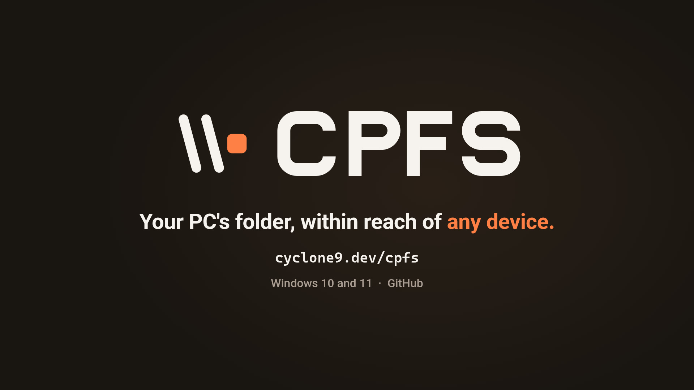

[English](README.md) · [فارسی](README.fa.md) · [العربية](README.ar.md) · [Türkçe](README.tr.md)

# CPFS - CyClone Power File Share

<p align="center"><picture><source media="(prefers-color-scheme: dark)" srcset="assets/cpfs-lockup-on-dark.svg"></picture></p>

<p align="center"><em>Bilgisayarınızdaki klasör, her cihazın erişiminde.</em></p>

| Sürüm | 1.0.0 (geliştirme aşamasında) |
|---|---|
| Platform | Windows 10 ve 11 (Ev veya Pro sürümü) |
| Gereksinimler | .NET Framework 4.8 (Windows 10 1903 ve sonrası ile Windows 11'de yerleşik gelir), Yönetici hakları |
| Ana sayfa | https://cyclone9.dev/cpfs |
| Lisans | MIT (yalnızca kod; bkz. [Lisans](#lisans)) |

<p align="center"><a href="assets/cpfs-video-en.mp4"></a></p>

<p align="center">CPFS'ye 30 saniyelik bir bakış. Videoyu açmak için görsele tıklayın.</p>

## CPFS ne yapar

CPFS, bir Windows 10 veya 11 bilgisayarındaki tek bir klasörü Windows, macOS, Linux, Android ve iOS cihazlarla paylaşır. Cihazlar bilgisayarın adıyla (`ComputerName.local`), Wi-Fi veya LAN adresiyle ya da bir VPN adresiyle bağlanır; telefon QR koduyla da bağlanabilir. Paylaşım yalnızca o klasörle sınırlıdır, ayrı bir hesap ve sertleştirilmiş Windows ayarları kullanılır; Kaldırma özgün ayarları geri getirir.

## İndirme ve ilk çalıştırma

CPFS tek bir dosyadır: GitHub'daki [sürümler sayfasında](https://github.com/cyclone9/CPFS/releases) `Cpfs-0.8.0.exe`. Yükleyici yoktur; dosyayı istediğiniz yere kaydedip çalıştırın. CPFS yönetici haklarını yalnızca Kurulum, İzleme ya da Kaldırma gerektirdiğinde ister. Bağlan, Bu bilgisayarın bağlantıları, Tercihler ve Hakkında bunlar olmadan çalışır.

Dosya imzalı değildir; bu yüzden ilk çalıştırmada Windows SmartScreen "Windows bilgisayarınızı korudu" (Windows protected your PC) iletisini gösterir. Ek bilgi'yi (More info), ardından Yine de çalıştır'ı (Run anyway) seçin.

Dosyanın yayımlanan dosya olduğunu doğrulamak için PowerShell'de SHA-256 değerini hesaplayın ve sürüm sayfasındaki değerle karşılaştırın:

```powershell
Get-FileHash .\Cpfs-0.8.0.exe -Algorithm SHA256
```

CPFS için Windows 10 veya 11 ile .NET Framework 4.8 gerekir; ikisi de bunu içerir. CPFS Windows 11'de denendi. Windows 10 desteklenir ama henüz denenmedi.

CPFS çalıştıktan sonra Hakkında sayfası sonraki sürümleri kurabilir; bkz. [Güncelleme](#güncelleme).

## Özellikler

- Kurulum, İzleme, Bağlanma, Bu bilgisayarın bağlantıları ve Kaldırma sayfaları.
- Sistem, Açık ve Koyu temalı Windows 11 görünümü.
- İngilizce, Farsça, Arapça ve Türkçe. Windows'un görüntü dili bunlardan biriyse CPFS onu kullanır; Tercihler'den başka bir dil seçebilirsiniz.
- Kurulum, paylaşılan klasöre bir sürücü harfi, bir masaüstü kısayolu ve Dosya Gezgini'nin gezinti bölmesinde bir giriş verebilir. Harfi ve adları siz seçersiniz; üçünde de CPFS simgesi bulunur. Sürücü harfinde Gezgin, sizin adınız yerine diskin kendi adını gösterebilir. Gezinti bölmesi girişi, varsayılan olarak açık olan "Dosya Gezgini'nde göster" anahtarıdır.
- Kurulum ya da Kaldırma Windows'ta değişiklik yapmadan önce, işaretini kaldırmazsanız CPFS bir geri yükleme noktası oluşturur. Windows son 24 saat içinde bir tane oluşturduğu için yenisini çoğu zaman atlar. Bu durumda CPFS en yeni geri yükleme noktasını tarihiyle birlikte söyler ve Sistem Geri Yükleme'nin onu nerede listelediğini gösterir (Control Panel > Recovery > Open System Restore). Yeni nokta olmadan devam edip etmeyeceğinize siz karar verirsiniz.
- Windows, macOS, Linux, Android ve iOS için bağlantı kılavuzu, telefonlar için QR kodlarıyla; `.local` adı, Wi-Fi veya LAN IP adresi ya da VPN adresi üzerinden. Windows adımları 1219 hatasını anar ve Bu bilgisayarın bağlantıları sayfasına yönlendirir.
- Bu bilgisayarın bağlantıları, bu bilgisayarın bağlı olduğu SMB paylaşımlarını listeler ve bağlantıyı keser. Paylaşan bilgisayar için değil, bağlanan bilgisayar içindir.
- İzleme, bağlı cihazları ve trafiklerini gösterir; o anda kopyalanan büyük aktarımları ("Şu anda kopyalananlar"), Son etkinliği ve başarısız oturum açma denemelerini de listeler. Son etkinlik, paylaşılan klasörde eklenen, değiştirilen, yeniden adlandırılan veya silinen her dosyayı gösterir; değişiklik herhangi bir cihazdan ya da bu bilgisayardan gelmiş olabilir. CPFS değişikliğin hangi cihazdan geldiğini söyleyemez.
- Son etkinlik için isteğe bağlı "Günlük dosyasına kaydet" anahtarı; varsayılan olarak kapalıdır.
- İsteğe bağlı bir Otomatik Özel anahtarı ve bilgisayar adını değiştirme seçeneği; ikisi de aşağıda anlatılıyor.
- Paylaşımın açık olup olmadığını gösteren isteğe bağlı bir sistem tepsisi simgesi ve isteğe bağlı olarak Windows ile başlatma.
- Hakkında sayfasında "Güncellemeleri denetle" düğmesi ve CPFS açılırken isteğe bağlı denetim; varsayılan olarak kapalıdır. Denetim yalnızca GitHub'a sorar. CPFS yeni bir sürümü yalnızca "Şimdi güncelle"ye bastığınızda indirir; bkz. Güncelleme.
- Özgün Windows ayarlarını geri yükleyen Kaldırma.
- Dosyalarınız silinmez. CPFS, paylaşılan klasördeki hiçbir şeyi kendiliğinden silmez, taşımaz ya da üzerine yazmaz.
- Önceki CPFS betikleriyle yapılmış kurulumlar algılanır.

## Otomatik Özel

Yerel ağda cihazlarınız yalnızca Windows'un Özel olarak adlandırdığı ağlar üzerinden bağlanır (bkz. Güvenlik sertleştirmesi). Otomatik Özel, Kurulum'da "Diğer seçenekler" altındaki bir anahtardır. Bu bilgisayarın ilk kez bağlandığı her ağı Özel olarak işaretler; böylece cihazlarınız Kurulum'u yeniden çalıştırmadan bağlanabilir. Varsayılan olarak kapalıdır ve kapalı olması daha güvenlidir.

Kafe, otel ve havalimanı Wi-Fi ağları da buna dahildir. CPFS güvenli bir ağı güvensizinden ayıramaz; Özel işaretlenmiş bir ağdaki yabancılar SMB parolanızı tahmin etmeye çalışabilir.

- Bir ağa bağlanıldığında `CPFS-AutoPrivate` adlı zamanlanmış görev, ağ Genel ise ve CPFS onu daha önce görmediyse Özel olarak işaretler. Her ağ yalnızca bir kez değiştirilir.
- Kurulum'da Genel bıraktığınız bir ağ ve VPN bağdaştırıcısı üzerindeki bir ağ hiçbir zaman değiştirilmez.
- Görev SYSTEM olarak, `C:\Program Files\CPFS\Cpfs.exe` içindeki bir CPFS kopyasından çalışır; bu kopyayı yalnızca SYSTEM ve Yöneticiler değiştirebilir. Bu klasör ya da `C:\ProgramData\CPFS` başka kullanıcılara açıksa görev çalışmayı reddeder.
- Değiştirdiği ağların adları `C:\ProgramData\CPFS\auto-private.log` dosyasında tutulur; Kaldırma bunları yeniden Genel yapabilsin diye.
- Kurulum'da anahtarı kapatmak görevi ve kopyayı kaldırır.

## Bilgisayar adı

Cihazlar bu bilgisayarı bilgisayar adı ve ardından `.local` ile bulur. Kurulum'da "Diğer seçenekler" altındaki Bilgisayar adı alanı geçerli adı gösterir; siz değiştirmedikçe hiçbir şey yeniden adlandırılmaz. Harf, rakam ve kısa çizgi kullanın, en çok 15 karakter olsun ve yalnızca rakamlardan oluşmasın.

Windows yeni adı ancak yeniden başlatmadan sonra alır. CPFS, bir etki alanına katılmış bilgisayarı yeniden adlandırmaz. Bir kuruluşun yönetebileceği Entra ID'ye katılmış bilgisayarda, bunu soran öğeyi işaretlerseniz yeniden adlandırır. Özgün ad yedekte tutulur; Kaldırma onu geri vermeyi önerir, bu da yeniden başlatmadan sonra geçerli olur.

## Sistem tepsisi simgesi ve Windows ile başlatma

Sistem tepsisi simgesi varsayılan olarak kapalıdır; Tercihler'den açarsınız. Paylaşımın açık olup olmadığını ve bu bilgisayarın Özel ya da Genel bir ağda olup olmadığını gösterir; Genel ağ, telefonun bağlanamamasının olağan nedenidir. Menüsü CPFS'yi açar, paylaşılan klasörü açar ya da simgeden çıkar; simgeyi seçmek de CPFS'yi açar. Bildirim göstermez: başarısız oturum açmaları okumak yönetici hakları gerektirir, bu yüzden bunlar İzleme'de kalır.

Simge hiçbir zaman yönetici olarak çalışmaz. Yönetici haklarıyla başlatılırsa kapanır; bu yüzden Kullanıcı Hesabı Denetimi'nin kapalı olduğu bir bilgisayarda ya da yerleşik Administrator hesabında kullanılamaz. Yönetici haklarıyla çalışan bir CPFS penceresi simgeyi kapatabilir ama açamaz. Açmak için CPFS'yi yönetici hakları olmadan açın.

Simge çalışırken, yönetici hakları olmadan çalışan bir CPFS penceresini küçültmek onu sistem tepsisine gönderir ve simge onu geri getirir. Yönetici haklarıyla çalışan pencere her zamanki gibi küçülür. Pencereyi kapatmak CPFS'den çıkar, simge kalır.

Windows ile başlat, Tercihler'de yalnızca simge açıkken kullanılabilen bir anahtardır. `HKCU\Software\Microsoft\Windows\CurrentVersion\Run` altına `CPFS` adlı bir değer ekler; bu değer pencereyi değil simgeyi, anahtarı açtığınız exe dosyasından başlatır. Ayarlar > Uygulamalar > Başlangıç (Settings > Apps > Startup) altında da listelenir ve oradan da yönetebilirsiniz. Simgeyi kapatmak Windows ile başlatmayı da kapatır. O exe sonradan taşınır ya da silinirse Tercihler, Windows'un onu nereden başlatacağını gösterir ve "Bu kopyayı kullan"ı (Use this copy) önerir.

Çalışan simge exe dosyasını kullanımda tutar. exe dosyasını silmeden ya da taşımadan önce simgeden çıkın; menüsünden ya da Tercihler'deki anahtarla.

Kaldırma, başlatma değerini siler ve simgeyi kapatır.

## Bu bilgisayarın bağlantıları

Bu sayfa, başka sunuculara bağlanan bir bilgisayar içindir. Bağlan, diğer cihazların bu bilgisayara nasıl ulaştığını gösterir. Bu bilgisayarın bağlantıları ise bu bilgisayarın bağlı olduğu SMB paylaşımlarını gösterir; yani ters yöndür.

Her bağlantıyı, Windows'un tuttuğu sunucu adı, paylaşım, varsa sürücü harfi, hesap ve durumla listeler. Oturum açılınca yeniden bağlanan sürücüleri işaretler, şu an bağlı olmayan kayıtlı sürücüleri de listeler. SMB kullanmayan sürücüler, örneğin SSHFS-Win'den biri, listelenmez. CPFS'nin kendi sürücü harfi bir bağlantı olmadığı için o da listelenmez. Sayfa hiçbir zaman kullanıcı adı ya da parola istemez.

Bağlantıyı kes önce sorar ve yalnızca o bağlantıyı sonlandırır. Bağlantı, oturum açılınca yeniden bağlanan eşlenmiş bir sürücüyse Bağlantıyı kes onu kayıttan da çıkarır; Dosya Gezgini ve `net use /delete` da öyle yapar, pencere bunu söyler. Geri getirmek için sürücüyü yeniden eşlersiniz. Bağlantıdaki dosyalar açıksa Windows reddeder. O zaman ikinci bir pencere, bu dosyalardaki kaydedilmemiş değişikliklerin kaybolabileceği konusunda uyarır ve bağlantıyı yalnızca onun "Yine de bağlantıyı kes" (Disconnect anyway) düğmesi zorla keser. "Bu sunucuya olan tüm bağlantıları kes" bir kez sorar ve hiçbir zaman zorlamaz. CPFS neyi kestiğini, parola olmadan, günlüğe yazar. Bu Bağlantıyı kes, İzleme'deki değildir; o, bir cihazın bu bilgisayarın paylaşımındaki oturumunu sonlandırır.

Sayfa yalnızca yönetici hakları olmadan çalışan bir pencerede çalışır. Windows bağlantıları ve sürücü eşlemelerini oturum açma oturumu başına ayrı tutar; yönetici haklarıyla çalışan pencere aynı kullanıcının başka bir oturumundadır. Yanlış bağlantıları listeler ve kaldırırdı, bu yüzden orada sayfa yalnızca bir not gösterir, liste göstermez. Not, başka bir sayfada Yönetici olarak devam et'i seçtiğiniz için pencerenin yönetici haklarıyla çalıştığını açıklar. **Reopen without administrator rights** (Yönetici hakları olmadan yeniden aç) düğmesi CPFS'yi bu sayfada normal biçimde açar.

### Sunucu başına bir kullanıcı adı

Windows aynı anda sunucu başına yalnızca bir kullanıcı adına izin verir. Bir sunucuya bir hesapla, ardından aynı sunucuya başka bir hesapla bağlanırsanız Windows 1219 hatasıyla reddeder. Windows yazdığınız ada bakar; ad yerine IP adresiyle bağlanmak başka bir sunucu sayılır. Bu, Microsoft'un bu hata için kendi önerdiği geçici çözümdür (KB 938120 destek makalesi).

Başka bir Windows bilgisayardan bir CPFS paylaşımına bağlanırken 1219 hatasını alırsanız o bilgisayarda CPFS'yi açıp Bu bilgisayarın bağlantıları sayfasına gidin. O sunucuyla var olan bağlantıyı kesin, sonra istediğiniz hesapla yeniden bağlanın.

Windows bir bağlantıyı sonlandırmayı yine reddederse sayfa denenebilecekleri şu sırayla listeler: o sunucuyu kullanan her pencereyi ve uygulamayı kapatın; sunucuya adıyla değil IP adresiyle bağlanın (Microsoft'un önerdiği çözüm, KB 938120); Windows'tan çıkıp yeniden oturum açın.

## Güncelleme

Daha yeni bir sürüm olduğunda Hakkında sayfası "Şimdi güncelle" (Update now) düğmesini gösterir. CPFS kendi kendini hiçbir zaman güncellemez; o sürümün düğmesine basana kadar hiçbir şey indirilmez. Düğme yalnızca yönetici hakları olmadan çalışan bir pencerede çalışır. Yönetici haklarıyla çalışan pencerede devre dışı kalır, sürüm sayfasının bağlantısı durur. Sistem tepsisi simgesi ve arka plan görevi hiçbir şey indirmez.

CPFS neyin yeni olduğunu gösterir ve onay ister. Sonra `Cpfs-<version>.exe` dosyasını ve `.sha256` dosyasını GitHub'daki o sürümden, HTTPS üzerinden ve hiçbir kimlik bilgisi göndermeden indirir. exe dosyasını yalnızca şunların hepsi doğruysa değiştirir:

- Sürüm, çalışan sürümden yüksek, sade bir sürüm numarasıdır.
- İndirilen dosyanın SHA-256 değeri yayımlanan `.sha256` ile eşleşir.
- Dosyanın içindeki sürüm, yayımlanan sürümdür.
- Yeni exe, CPFS değiştirmeden önce onu bir kez çalıştırdığında başlar.

Bir denetim başarısız olursa hiçbir şey değiştirilmez. Exe değiştirildikten sonra CPFS yeniden başlar; onay penceresi de bunu söyler. Eski exe, yenisi başlayana kadar yenisinin yanında durur; yenisi başlamazsa CPFS eskisini yerine koyar. Eskisini yerine koyamazsa CPFS, adı geri çevrilecek klasörü ve dosyayı söyler; örneğin `Cpfs.exe.cpfs-old` dosyası `Cpfs.exe` olur.

SHA-256, bozuk bir indirmeye karşı korur. Ele geçirilmiş bir GitHub hesabına karşı korumaz, çünkü sağlama değeri aynı sürümden gelir; henüz bir imza da yoktur. Elle güncelleme, İndirme ve ilk çalıştırma bölümünde anlatıldığı gibi hâlâ çalışır.

CPFS'nin kurduğu dosya "internetten indirildi" işaretini almaz, bu yüzden SmartScreen yeniden sormaz. Bu imzalama değildir: ilk indirmeniz yine SmartScreen'e takılır ve CPFS'nin kurduğu sürümler HTTPS'ye, GitHub'a ve sağlama değerine dayanır. CPFS yönetici hakları istediğinde Windows yine "Bilinmeyen yayımcı" (Unknown publisher) gösterir.

Dosya adını ve klasörünü korur. `Cpfs-1.0.0.exe` güncellemeden sonra daha yeni bir sürüm taşıyabilir; Hakkında sayfası ve pencere başlığı gerçek sürümü gösterir. Kısayollar, sabitlemeler ve başlatma girişi çalışmaya devam eder.

CPFS, bir ağ sürücüsünde ya da yazamadığı bir klasörde (örneğin `C:\Program Files` altındaki bir klasör) exe dosyasını yerinde değiştiremez. Bunun yerine "Farklı kaydet" (Save as) önerir ve denetlenmiş dosyayı seçtiğiniz yere yazar; exe yazmak için hiçbir zaman yönetici hakları istemez. Bundan sonra başlatma girişi hâlâ eski dosyayı gösterir ve Tercihler "Bu kopyayı kullan"ı önerir.

Güncelleme `C:\Program Files\CPFS` içindeki kopyayı değiştirmez. O kopya yalnızca Kurulum'da Uygula'ya (Apply) bastığınızda değişir; o zamana kadar Otomatik Özel eski kopyayı kullanmaya devam eder. CPFS bunu güncellemeden sonra size söyler.

CPFS çalışırken exe dosyasının yanına, onun adını taşıyan ve `.cpfs-old`, `.cpfs-failed` ve `.cpfs-update.exe` ile biten geçici dosyalar koyar. Bir sonraki başlangıçta bunları siler. Bir güncelleme yanlış anda kesilirse ve exe dosyası yoksa `.cpfs-old` dosyasını exe dosyasının adına geri çevirin.

## Güvenlik sertleştirmesi

Kurulum yalnızca bu bölümdeki Windows ayarlarını değiştirir. Hiçbir ayarı Windows'un varsayılanından zayıf yapmaz; CPFS'nin değerinden zaten daha katı olan bir ayar olduğu gibi bırakılır. İlk değişiklikten önce Kurulum her özgün değeri `config.json` içinde `Backup` altına kaydeder. Yedeği bir daha almaz; bu yüzden Kaldırma, CPFS'den önceki değerleri geri yükler.

Kurulum, bir şeyi değiştirmeden önce bir plan gösterir. Var olan bir hesabı kullanmak, bir paylaşımı değiştirmek ve Genel bir ağı Özel yapmak yalnızca işaretlerseniz yapılır.

### SMB hesabı

| Ayar | CPFS'nin ayarladığı | Neden |
|---|---|---|
| Hesap | Kurulum'da SMB kullanıcı adı olarak verilen, ayrı bir yerel hesap | Cihazlar bununla oturum açar, Windows hesabınızla değil |
| Gruplar | Kullanıcılar grubunun üyesi, Yöneticiler grubunun üyesi değil | Sızan bir dosya paylaşımı parolası Windows'u değiştiremez |
| Parola | Yazdığınız parola; Windows üzerinden ayarlanır, CPFS kaydetmez | Sonraki bir çalıştırmada kutuyu boş bırakırsanız mevcut parola kalır |
| Parola süresi | Hiç dolmaz | Süresi dolmuş bir parola tüm cihazları dışarıda bırakırdı |
| Oturum açma ekranı | Gizli; `HKLM\SOFTWARE\Microsoft\Windows NT\CurrentVersion\Winlogon\SpecialAccounts\UserList` altında `0` değeri | Hesap cihazlar içindir, bu bilgisayarın başındaki kişiler için değil |
| Aynı adlı bir hesap zaten var | Yalnızca işaretlerseniz kullanılır; ayarları önce kaydedilir ve Yöneticiler grubundan çıkarılması önerilir | CPFS bir hesabı sessizce devralmaz |

### Paylaşılan klasör ve paylaşım

| Ayar | CPFS'nin ayarladığı | Neden |
|---|---|---|
| Klasör izni | SMB hesabı, paylaşılan klasörde ve içindekilerde Değiştirme iznini alır | Cihazlar dosya ekleyip değiştirebilir |
| Paylaşım izni | SMB hesabının paylaşım üzerinde tam denetimi vardır; CPFS'nin ayarladığı tek giriş budur. Diğer girişler yalnızca işaretlerseniz kaldırılır | Paylaşıma yalnızca bu hesap erişir |
| Klasör listesi | Hesabın açamadığı klasörler gizli kalır | Erişimin dışındaki hiçbir şey gösterilmez |
| Çevrimdışı dosyalar | Paylaşım için kapalı | Dosyalarınızın çevrimdışı kopyaları çıkmaz |
| Katı mod (isteğe bağlı) | Paylaşım SMB 3 şifrelemesi ister | Şifreleyemeyen cihazlar reddedilir |
| Yönetimsel paylaşımlar (`ADMIN$`, `C$` vb.) | `HKLM\SYSTEM\CurrentControlSet\Services\LanmanServer\Parameters` altında `AutoShareWks` değeri `0`; var olanlar, kaldırılmasını işaretlemedikçe yeniden başlatmaya kadar durur | Windows tüm sürücüleri ağda paylaşmaz |
| CPFS'nin oluşturmadığı bir paylaşım | Yalnızca işaretlerseniz değiştirilir; ne olduğu kaydedilir | CPFS sormadan bir paylaşımı kaldırmaz |

### SMB sunucusu

| Ayar | CPFS'nin ayarladığı | Neden |
|---|---|---|
| Sunucu hizmeti | Otomatik başlar | Paylaşım onsuz çalışmaz |
| SMB 2 ve SMB 3 | Açık | Güncel her cihaz bunlardan birini kullanır |
| Şifrelenmemiş erişimi reddet | Açık | Şifreleme isteyen bir cihaz sonra onsuz yeniden deneyemez |
| SMB 1 protokolü | Kapalı | Eski ve güvensizdir, kapalı kalır |
| SMB 1 Windows özelliği | Kuruluysa kaldırılır; bunun için yeniden başlatmak gerekir ve çok eski ağ sürücüleri için SMB 1 istemcisi de kalkar | SMB 1 kazara geri gelemez |

### Oturum açma güvenliği

İlk yedisi kayıt defteri değerleridir ve `HKLM\SYSTEM\CurrentControlSet\Control\Lsa` altındadır; yalnızca `RestrictNullSessAccess`, `HKLM\SYSTEM\CurrentControlSet\Services\LanmanServer\Parameters` altındadır.

| Ayar | CPFS'nin ayarladığı | Neden |
|---|---|---|
| `forceguest` | `0` | Ağdan oturum açma, adı verilen hesapla yapılır, Konuk olarak değil |
| `LmCompatibilityLevel` | `5` | Yalnızca NTLMv2 kabul edilir |
| `NoLMHash` | `1` | Windows, parolanın zayıf LM karmasını saklamaz |
| `RestrictAnonymous` | `1` | Anonim kullanıcılar paylaşımları ve hesap adlarını listeleyemez |
| `RestrictAnonymousSAM` | `1` | Anonim kullanıcılar bu bilgisayarın hesaplarını listeleyemez |
| `EveryoneIncludesAnonymous` | `0` | Herkes grubu anonim kullanıcıları içermez |
| `RestrictNullSessAccess` | `1` | Anonim oturumlar paylaşımlara erişemez |
| Konuk hesabı | Kapalı ve kapalı kalır | Parolasız erişim yoktur |
| Hesap kilitleme | Bir hesap 10 yanlış paroladan sonra kilitlenir. Bu yalnızca kilitleme kapalıyken ayarlanır; zaten bir eşiğiniz varsa o kalır | Parola tahmini engellenir |
| Başarısız oturum açma denetimi | Başarısızlıklar Güvenlik günlüğüne yazılır; başarılı oturum açmalar eskisi gibi kalır | İzleme bunları gösterir |

### Güvenlik duvarı ve ağlar

| Ayar | CPFS'nin ayarladığı | Neden |
|---|---|---|
| `CPFS SMB (LAN)` | Gelen TCP 445, Özel ağlar, yalnızca yerel alt ağ | Ağınızdaki cihazlarınız bağlanabilir |
| `CPFS mDNS (LAN)` | Gelen UDP 5353, Özel ağlar | `.local` adı çalışır |
| `CPFS SMB (VPN)` | `100.64.0.0/10` ve `fd7a:115c:a1e0::/48` adreslerinden gelen TCP 445; yalnızca Tailscale veya Headscale bağdaştırıcısı üzerinden ve yalnızca böyle bir bağdaştırıcı bulunursa | Cihazlarınız VPN üzerinden bağlanır. Genel bir ağdaki bağdaştırıcı yalnızca işaretlerseniz kullanılır, çünkü bazı otel ve mobil ağlar bu aralıktan adres verir |
| Yeni kurallar | Kapalı oluşturulur, geri okunur ve yalnızca eşleşirse açılır | Kapsamı yanlış bir kural hiçbir zaman bağlantı noktası açmaz |
| Genel ağlarda 445 numaralı bağlantı noktasını açan yerleşik Dosya ve Yazıcı Paylaşımı kuralları | Kapatılır ve kaydedilir; Kaldırma bunları yeniden açabilir | 445 numaralı bağlantı noktası Genel bir ağda hiçbir zaman açılmaz |
| Ağ türü | Genel bir ağ yalnızca işaretlerseniz Özel olur | CPFS'nin kuralları yalnızca güvendiğiniz ağlarda geçerlidir |

### Veri klasörü ve hızlı erişim

| Ayar | CPFS'nin ayarladığı | Neden |
|---|---|---|
| `C:\ProgramData\CPFS` | Sahibi Yöneticiler grubu; yalnızca SYSTEM ve Yöneticiler yazabilir | SYSTEM olarak çalışan bir görev bu klasörden okur, bu yüzden başka hiçbir kullanıcı onu değiştiremez |
| Otomatik Özel (isteğe bağlı) | `CPFS-AutoPrivate` görevi ve `C:\Program Files\CPFS` içindeki kopya; bkz. Otomatik Özel | Yeni ağlar Özel olarak işaretlenir |
| Bilgisayar adı (isteğe bağlı) | Yeniden başlatmadan sonra yeni ad; bkz. Bilgisayar adı | Cihazlar bilgisayarı bu adla bulur |
| Sürücü harfi (isteğe bağlı) | `HKLM\SYSTEM\CurrentControlSet\Control\Session Manager\DOS Devices` altında kalıcı bir eşleme; oturumunuzda da hemen görünür. Yalnızca boş bir harf | Paylaşılan klasör bir sürücü olarak görünür |
| Sürücü adı ve simgesi (isteğe bağlı) | `HKLM\SOFTWARE\Microsoft\Windows\CurrentVersion\Explorer\DriveIcons\<letter>` altındaki değerler; harfin zaten sahip olduğu ad ya da simge önce kaydedilir | Dosya Gezgini sizin adınızı ve CPFS simgesini gösterir |
| Masaüstü kısayolu (isteğe bağlı) | Ortak Masaüstü'nde bir `.lnk` dosyası; CPFS'nin oluşturmadığı aynı adlı bir dosyanın üzerine hiçbir zaman yazılmaz | Paylaşılan klasöre kısayol |
| Dosya Gezgini girişi (isteğe bağlı) | Kaldırma bölümünde listelenen anahtarlar, Kurulum'u çalıştıran kullanıcının kovanında | Paylaşılan klasör gezinti bölmesinde görünür |

CPFS, başka bir yere bağlantı olan bir veri klasörünü reddeder ve bir yöneticinin ya da SYSTEM'in yazmadığı ayar dosyasına güvenmez.

## Kaldırma

Kaldırma, Kurulum'un değiştirdiği Windows ayarlarını geri getirir ve CPFS'nin oluşturduklarını siler. Paylaşılan klasör ve içindeki dosyalar yerinde kalır: CPFS dosyalarınızı hiçbir zaman silmez. Bir şey değişmeden önce Kaldırma, işaretini kaldırmazsanız bir geri yükleme noktası oluşturur ve `config.json` dosyasının bir kopyasını (özgün ayarlarınızın yedeğiyle birlikte, parola içermez) Belgeler klasörünüze `CPFS-config-backup-<date>-<time>.json` adıyla kaydeder.

| Ne | Kaldırma ne yapar |
|---|---|
| Paylaşım | Cihazların bağlantısını keser ve paylaşımı kaldırır. Aynı adlı ama başka bir klasörü gösteren paylaşım, işaretlemedikçe kalır. |
| Klasör izni ve sahiplik | Kurulum'un SMB hesabına verdiği izni kaldırır. Hesabın sahibi olduğu dosya ve klasörlerin (yüklemeler gibi) sahibi Windows kullanıcınız olur. Bunun işaretini kaldırabilirsiniz. |
| SMB hesabı | Yalnızca CPFS oluşturduysa silinir. Önceden var olan bir hesap, silinmesini işaretlemedikçe kalır ve Kurulum'dan önceki ayarlarına döner. Hesabın profil klasörü yalnızca işaretlerseniz silinir. |
| Güvenlik duvarı | CPFS kurallarını kaldırır, Kurulum'un kapattığı yerleşik kuralları yeniden açar. |
| Güvenlik ayarları | Yedekteki değerleri geri koyar: Sunucu hizmetinin başlangıcı, SMB 2 ve SMB 3, şifrelenmemiş erişimi reddetme, hesap kilitleme ve Güvenlik sertleştirmesi'ndeki kayıt defteri değerleri. SMB 1 kapalı kalır, Konuk hesabı kapalı kalır ve başarısız oturum açmalar kaydedilmeye devam eder. Kaldırma, `RestrictAnonymousSAM`, `RestrictNullSessAccess`, `NoLMHash` ve `EveryoneIncludesAnonymous` değerlerini hiçbir zaman yeni bir Windows kurulumundakinden daha zayıf yapmaz. Yedekte özgün değeri olmayan bir değer olduğu gibi bırakılır. |
| Yedeksiz bir kurulum | Kurulumu erken bir CPFS sürümü yapmıştır, bu yüzden hiçbir şey geri yüklenmez. Yönetimsel paylaşımları, NTLM düzeyini ve anonim erişimi Windows'un varsayılanlarına döndüren bir öğeyi işaretleyebilirsiniz. |
| Ağlar | Kurulum'un Özel yaptığı ağlar ve Otomatik Özel'in Özel yaptığı ağlar yeniden Genel olur. Şu an bağlı olmayan bir ağ, kayıtlı ağ listesinde değiştirilir. |
| Otomatik Özel | Önce `CPFS-AutoPrivate` görevini, sonra `C:\Program Files\CPFS\Cpfs.exe` kopyasını, sonra da CPFS oluşturduysa ve boşsa `C:\Program Files\CPFS` klasörünü kaldırır. CPFS'nin oluşturmadığı klasör kalır. |
| Bilgisayar adı | Özgün adı geri vermeyi önerir. Bilgisayarda hâlâ CPFS'nin verdiği ad varsa işaretli gelir, o zamandan beri biri yeniden adlandırdıysa işaretsiz. Windows adı yeniden başlatmadan sonra alır. |
| Sürücü, sürücü adı ve simge | Sürücü eşlemesini ve CPFS'nin koyduğu adı ve simgeyi kaldırır ya da harfin önceden sahip olduğu ad ve simgeyi geri koyar. Dosya Gezgini sürücüyü bir sonraki yeniden başlatmaya kadar gösterebilir. CPFS'nin koymadığı her şey kalır. |
| Masaüstü kısayolu | Hâlâ paylaşılan klasörü gösteriyorsa kaldırılır. |
| Dosya Gezgini girişi | Hâlâ paylaşılan klasörü açıyorsa, aşağıda anlatıldığı gibi kaldırılır. |
| Windows ile başlatma | `HKCU\Software\Microsoft\Windows\CurrentVersion\Run` altındaki `CPFS` değerini, Kurulum'u çalıştıran kullanıcının kovanında siler ve simgeyi kapatır. Bu adı taşıyan ama CPFS'nin yazmadığı bir değer kalır. Bilgisayardaki diğer Windows hesapları kendi değerlerini korur. |
| `C:\ProgramData\CPFS` | En son, `config.json` ve `cpfs.ico` ile birlikte kaldırılır. Kurulum'un kenara ayırdığı ayar dosyaları (`config-ignored-<date>.json`) önce Belgeler klasörünüze `CPFS-config-ignored-<date>.json` adıyla kopyalanır; kopyalama başarısız olursa klasör kalır. |

Dosya Gezgini girişi `HKCU\Software\Classes\CLSID\{07C33AB4-B371-467B-9DC1-1AA530E251C6}` ve `HKCU\Software\Microsoft\Windows\CurrentVersion\Explorer\Desktop\NameSpace\{07C33AB4-B371-467B-9DC1-1AA530E251C6}` anahtarlarından, ayrıca `HKCU\Software\Microsoft\Windows\CurrentVersion\Explorer\HideDesktopIcons\NewStartPanel` altındaki `{07C33AB4-B371-467B-9DC1-1AA530E251C6}` değerinden oluşur; hepsi Kurulum'u çalıştıran kullanıcının kovanındadır. Sürücü simgesi (`HKLM\SOFTWARE\Microsoft\Windows\CurrentVersion\Explorer\DriveIcons\<letter>\DefaultIcon`) silinir ya da harfin önceden sahip olduğu simge geri konur. CPFS'nin koymadığı bir simge yerinde kalır.

## CPFS verileri nerede tutar

- `C:\ProgramData\CPFS`: yanıtlarınızı ve özgün ayarların yedeğini içeren `config.json`; CPFS'nin güvenemediği, Kurulum'un yeniden adlandırıp artık okumadığı ayar dosyası `config-ignored-<date>.json`; sürücünün, kısayolun ve Dosya Gezgini girişinin kullandığı CPFS simgesi `cpfs.ico`; Otomatik Özel açıkken de `auto-private.log` (değiştirdiği ağlar) ve `auto-private-run.log` (görevin her çalışması için bir satır). Buraya yalnızca SYSTEM ve Yöneticiler yazabilir.
- `C:\Program Files\CPFS\Cpfs.exe`: Otomatik Özel görevinin çalıştırdığı kopya; yalnızca Otomatik Özel açıkken bulunur. Yalnızca SYSTEM ve Yöneticiler değiştirebilir.
- CPFS'yi çalıştıran kullanıcının profilindeki `%LOCALAPPDATA%\CPFS` klasörü:
  - `preferences.json`: uygulamadaki seçimleriniz; tema, dil ve yazı tipi gibi, ayrıca tepsi simgesinin açık olup olmadığı (`TrayIcon`) ve Bağlan'da en son seçtiğiniz cihaz sekmesi (`ConnectDevice`).
  - `devices.json`: bağlı cihazlara verdiğiniz adlar.
  - `cpfs-log.txt`: uygulamanın kendi günlüğü.
  - `activity-log.txt` ve `activity-log.old.txt`: Son etkinlik; yalnızca "Günlük dosyasına kaydet" açıkken yazılır. Dosya 5 MB'a ulaşınca `activity-log.old.txt` olur. Dosya adları içerdiği için Raporu kopyala'ya hiçbir zaman eklenmez. Kaldırma onu silmez, çünkü size ait bir günlüktür.
- `HKCU\Software\Microsoft\Windows\CurrentVersion\Run` altındaki `CPFS` değeri: Windows ile başlatmanın başlangıç girişi; yalnızca o anahtar açıkken bulunur.
- exe dosyasının yanında, yalnızca bir güncelleme sırasında: `.cpfs-old`, `.cpfs-failed` ve `.cpfs-update.exe` ile biten dosyalar.
- `Documents\CPFS-config-backup-<date>-<time>.json`: Kaldırma'nın bir şey değiştirmeden önce kaydettiği `config.json` kopyası. Kaldırma onu yerinde bırakır.
- `Documents\CPFS-config-ignored-<date>.json`: Kaldırma'nın veri klasörünü kaldırmadan önce kaydettiği, kenara ayrılmış ayar dosyasının kopyası. Kaldırma onu yerinde bırakır.

Kaldırma, `%LOCALAPPDATA%\CPFS` içinde hiçbir şeyi silmez.

## Lisans

CPFS, MIT lisansıyla yayımlanır (bkz. `LICENSE`).

MIT lisansı CPFS'nin kodunu ve belgelerini kapsar. CPFS adını ve logosunu, uygulama simgesini (`src/Cpfs/Assets/cpfs.ico` dosyası ve `src/Cpfs/Brand.xaml` içindeki çizimi) ve `assets/` içindeki kapak görsellerini ile videoları kapsamaz. Bunlar CyClone'a aittir, tüm hakları saklıdır. Videolardaki müzik CPFS'nin parçası değildir ve MIT lisansının kapsamında değildir.

`src/Cpfs/Assets/Fonts/` içindeki Vazirmatn yazı tipi SIL Open Font License 1.1 altındadır (`OFL.txt` orada). Üçüncü taraf kütüphaneler `THIRD-PARTY-NOTICES.md` dosyasında listelenmiştir.

© CyClone · https://cyclone9.dev/
